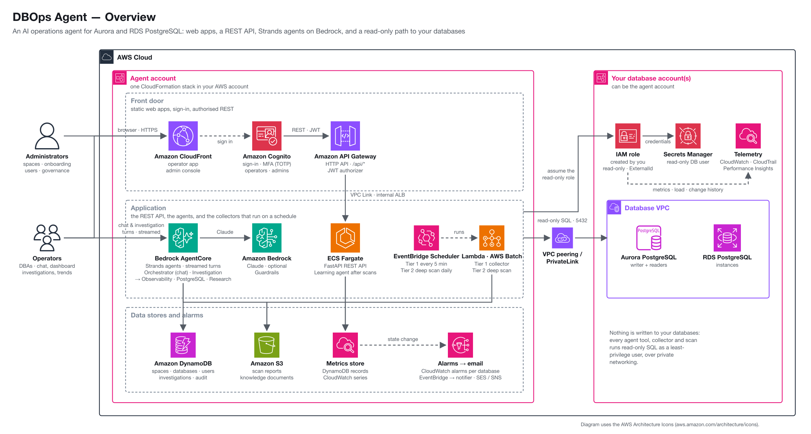
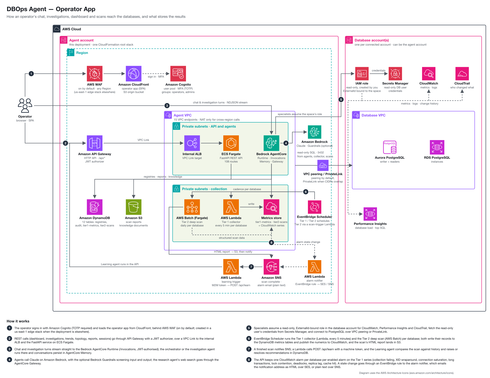
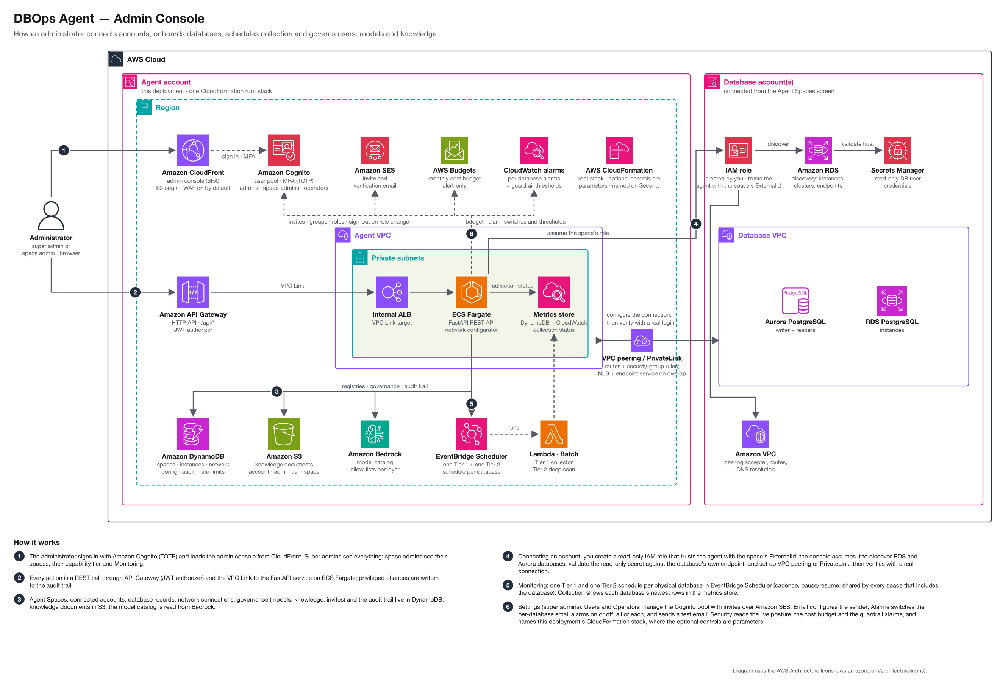

# Architecture — DBOps Agent

This document describes the system architecture, multi-agent design, execution paths,
network connectivity, Agent Spaces, investigations, topology, and the complete tool inventory.

## Overview

The platform uses a hybrid architecture with multiple execution paths:

1. **Batch Scans** — Shell script (v3.0, 10,800+ lines) runs in AWS Batch containers, producing comprehensive HTML reports with AI-generated analysis. CLI argument batch mode (no interactive prompts), Database Workload Profile query, improved pg_stat_statements handling.
2. **Agent Chat** — Multi-agent system using the Strands "Agents as Tools" pattern: a lightweight orchestrator delegates to engine-specific specialist sub-agents. Chat turns may carry an **Aurora role focus** (entire cluster / writer / readers): the server adds a `[ROLE FOCUS]` paragraph to the `[DATABASE SCOPE]` block it builds for the turn (the browser sends database ids and the focus, never the block), and reader-focused SQL connections are routed to the cluster reader endpoint (fail-soft to the writer; chat only, and forced off for investigations). A `reader` or `instance:<id>` focus goes through the same reachability gate as Tier 1 (`host_routes.dial_gate`), server-side in `pg_client`: a member the gate marks unreachable (a reader over a VPC Lattice resource endpoint, a host-route member without an owned `/32`, a name that does not resolve), or the reader endpoint over Lattice, returns that reason instead of a dial. Both member pickers show such members disabled, with the reason.
3. **Investigations** — Structured multi-step root cause analysis. The Investigation Agent loads engine-specific runbooks (SOPs) first, then delegates to the domain agents as tools, following the runbook protocol (typically CloudWatch → Performance Insights → CloudTrail → PostgreSQL → Correlation). Delegation is LLM-driven per the runbook, not a hardcoded pipeline. Single-database scoping enforced.
4. **Topology** — Network map built from DynamoDB data showing the agent VPC, accounts, regions, VPCs, databases, and how the agent reaches each database.
5. **Tier 1 Metrics Collection** — Lambda runs every 5 minutes per database, collecting PostgreSQL-internal metrics (cache hit ratio, dead tuples, XID age, connection states, locks, deadlocks, transaction and rollback rates, temp files, autovacuum, wait events), writing them to DynamoDB and publishing the numerics to CloudWatch custom metrics. These metrics are NOT in CloudWatch's RDS namespace.

All paths share infrastructure: Secrets Manager for credentials, DynamoDB for registries, S3 for reports, Cognito for auth, and VPC peering or a VPC Lattice resource endpoint for network connectivity.

## Multi-Agent Architecture

The platform uses a two-tier agent hierarchy: Supervisor Agents (entry points) delegate to Domain Agents (specialists). The overview diagram under [System Components](#system-components) places them in the deployment; the table is the reference.

| Agent | Tier | Tools | Entered from | Delegates to |
|---|---|---|---|---|
| Orchestrator | Supervisor | 9 | a chat turn (`POST /invocations`) | Observability, PostgreSQL, Research |
| Investigation | Supervisor | 11 | a started investigation (`[INVESTIGATION:{id}]` turn) | Observability, PostgreSQL, Research |
| Observability | Domain | 17 (CloudWatch, Performance Insights, CloudTrail, Logs) | either supervisor | — |
| PostgreSQL | Domain | 52, across 9 analysis sections | either supervisor | — |
| Research | Domain | managed web search + `fetch_doc_page` | either supervisor, and the Learning Agent | — |
| Learning | Separate entry point | 1 (Research) | a finished scan: SNS → Lambda → `POST /api/learn/{instance_id}`; not callable by either supervisor | Research |

**Orchestrator Agent** — handles chat. A pure router: identity/context and delegation tools only (analysis tools live on the workers so the coordinator cannot self-fabricate metrics). Routes questions to specialists, synthesizes responses, verifies recommendations via Research Agent. 7 base tools, plus a chat-surface `load_skill` **and** a chat-scoped `get_runbooks` when any skill declares the chat surface, which some do today. Prompt tuned for concise, interactive answers.

**Investigation Agent** — handles investigations. Shares the domain agents and utility tools with the Orchestrator, but adds `get_runbooks`, `load_skill`, and the analysis tools relocated to workers under coordinator hardening (`get_historical_metrics`, `assess_growth`, `get_instance_details`), and omits `recommend_investigation`. Its system prompt says "load runbooks first, then follow them"; its STEP 0 is to call `load_skill(slug)` for the one diagnostic skill matching the symptom (picked from the `skills_catalog` returned by `get_runbooks`). All accuracy guidelines, engine rules, and diagnostic patterns are externalized to runbook SOPs. Output organized per-database: Findings, Root Cause, Recommended Actions, Summary. Uses 32K max_tokens. Agent instances are LRU-cached per `{user_id}::{investigation_id}::{model_id}` (chat agents per `{user_id}::{session_id}::{model_id}`) so two callers never share a live agent's conversation state.

**Learning Agent** — triggered after scan completion via SNS → Lambda → API. Analyzes historical scan trends, detects metric degradation and finding recurrence, generates recommendations verified via Research Agent. Saves to DynamoDB with auto-resolution lifecycle.

**Domain Agents** — shared by supervisors. Observability Agent (17 AWS monitoring tools), PostgreSQL Agent (52 database analysis tools), Research Agent (managed AgentCore Web Search plus `fetch_doc_page`), Learning Agent (1 tool, trend analysis with doc verification). Each is a `@tool async generator` that streams events back via `SubAgentResult`. PostgreSQL Agent prompt requires labeling all data with source tags ([pg_stat_activity], [pg_stat_statements], etc.). The observability metric tools resolve Aurora clusters to writer-first role dicts and annotate each per-instance result with `role` (writer/reader), `is_writer`, a top-level `primary_instance`, an observed `data_window`, and `requested_hours`.

Why this pattern:
- LLM tool selection accuracy drops ~23% beyond 15 tools. Supervisors stay under that, at nine tools for chat and eleven for investigations, and delegate the heavy tool sets to domain agents.
- Separate prompts for chat vs investigation without affecting each other.
- Domain agents are engine-agnostic (observability) or engine-specific (PostgreSQL).
- Adding a new engine is one new file in `sub_agents/` + one line in both supervisors.
- All agents stream through AgentCore — real-time tool calls visible in Agent Trace.

## End-to-End Orchestration Flow

Three **independent** entry paths reach the agents. They are not stages of one pipeline.
a chat turn never becomes an investigation on its own, and the Learning Agent is not the
tail of an investigation.

| Path | Trigger | Tier | Entry point |
|---|---|---|---|
| **Chat** | Operator types a message | Orchestrator Agent (9 tools) | `POST /invocations` |
| **Investigation** | Operator explicitly starts one (often from a chat pill) | Investigation Agent (11 tools) | `POST /api/spaces/{id}/investigations` |
| **Scan → Learning** | Schedule fires an AWS Batch deep scan | Findings engine, then Learning Agent | SNS → Lambda → `POST /api/learn/{instance_id}` |

**The diagram lives in [`orchestration-flow.html`](orchestration-flow.html)** — a
self-contained page (no build step, no external assets, no JavaScript). Open it in a
browser from a clone, or download it from the repo and open locally; GitLab and Code
Browser will not render HTML inline. It shows the three lanes side by side, names the
actual tool called at each step, and closes with a "What's in the system" reference panel
listing the agents, runbooks, skills and check counts.

It is the canonical picture of this flow. When the orchestration changes, update that file
and this section together.

*Text fallback (same flow, no diagram):* **Chat** — message → guardrails already resident in
the prompt → classify into one of five intents → Lookup goes to one specialist for one tool
call; Diagnosis hits the hard gate and may only emit `recommend_investigation` (when the
request names no symptom at all it may first ask the operator one clarifying question with
symptom options, still with no tools, numbers or analysis, and the reply inherits the
diagnosis intent; a worded acceptance re-surfaces the button — only the click starts one);
Recommendation may load one of the 9 chat-surface skills; Explain answers directly or via
Research; Report reads the stored scan. **Investigation** — symptom → deterministic
substring pre-selection over curated triggers → agent built with guardrails plus the
recommended skill → `get_runbooks` (4 SOPs, one engine guide) → mandatory `load_skill`
STEP 0 → protocol baseline `get_current_activity` → delegate to Observability (17 tools)
and PostgreSQL (52 tools) → severity stamped in Python from `references.yaml` → Research
Agent verifies → structured per-database report. **Scan** — Batch scan → deterministic
findings engine (no LLM) → Tier 2 store and S3 → SNS → Lambda → `/api/learn` → Learning
Agent.

### What this flow is not

These are the misreadings the diagram is drawn to prevent:

| Common assumption | What the code actually does |
|---|---|
| Skill routing uses TF-IDF / embeddings / vector cosine similarity | **No.** `skill_match.select_skill` does case-insensitive **substring** matching against curated per-check `triggers`, then ranks by hit count → matched-trigger length → slug. No vectors, no scoring model, no index. |
| There is a RAG or document-search step | **No RAG anywhere.** Doc verification is the Research Agent issuing one managed web search and optionally fetching one cited page. Custom knowledge docs are composed and fenced, not retrieved by similarity. |
| There is a separate "lookup skill" or "doc search skill" | **No.** A Lookup is one direct specialist call. Skills are investigation procedures; only 9 of the 32 also appear on the chat surface. |
| The chat agent gathers a little context before offering an investigation | **Forbidden.** The hard gate allows exactly one action for Diagnosis: `recommend_investigation`: with no numbers or analysis emitted first. The one thing it may do first, and only when the request names no symptom at all, is ask the *operator* one clarifying question offering symptom options (no tool calls while asking); the reply inherits the diagnosis intent and goes to `recommend_investigation`. The chat's follow-up pills turn into one-click replies for that turn. Inline chat diagnosis caused fabrication in earlier runs. This gate is a **prompt-level** rule (carried in the always-on guardrail SOP and intent classification), not a server-side tool binding; it exists for answer quality, and safety does not rest on it because every agent tool is read-only regardless (see the security section). |
| A skill's `allowed-tools` frontmatter restricts, at runtime, which tools the agent may call | **No.** `allowed-tools` is advisory skill-authoring metadata; it is stripped from the injected skill body and no runtime code reads it. What actually bounds an agent's tools is the fixed set it is constructed with per surface (chat vs investigation), on top of which every tool is read-only. |
| A model decides how severe a finding is | **No.** Tool SQL returns raw facts; severity bands come from `checks/references.yaml` and are applied in Python (`_severity_from_bands` and friends in `db_tools.py`). |
| The Learning Agent runs at the end of an investigation | **No.** It runs on the scan path: Batch scan completes → SNS → Lambda → `/api/learn`. It never fires from an investigation. |
| Guardrails are loaded as one of the runbooks | **No.** `diagnostic-guardrails.sop.md` is injected into both system prompts at agent-build time (`load_guardrails`), so it applies before any tool runs and whether or not a skill loads. |
| An investigation loads both engine SOPs | **No.** `_ENGINE_SOP_MAP` resolves the database's engine to exactly one of Aurora / RDS. |

## System Components

Three diagrams: one overview, then one per audience that names the AWS service at every hop
and closes with a numbered "How it works". They live in [`diagrams/`](diagrams/) as SVG
(source of truth, renders on GitHub) and PNG (for the README), generated by
[`diagrams/build_diagrams.py`](diagrams/build_diagrams.py) from the
[AWS Architecture Icons](https://aws.amazon.com/architecture/icons/); regenerate them with that
script when a component is added or moved, rather than editing the files by hand. There is
no text copy of these pictures to keep in step; the tables and lists in the rest of this
document carry the detail the diagrams leave out.

**Overview** — who uses the product, the three bands of the deployment (front door,
application, data stores) and the read-only path into your database accounts:



**Operator app** — how a chat turn, an investigation, a dashboard view and a scheduled scan
reach the databases, and where the results land:



**Admin console** — connecting an account, discovering and onboarding databases, scheduling
collection, and governing users, models and knowledge:



## Agent Spaces

Agent Spaces define the boundary of what the agent can access:

```
Space
├── Primary Account (auto-detected)
├── Secondary Accounts (with cross-account IAM roles)
├── Regions (selected by admin)
├── Databases (discovered via RDS API → onboarded with a secret, per space)
├── Operators (assigned via Cognito groups; the 4th step of space setup)
└── Network Connections (peering / Lattice resource endpoint, tracked in registry)
```

- **Admin Console** manages spaces through a linear setup: cloud sources → regions and
  access → discover and onboard databases → assign operators
- **Operator App** is scoped to the user's assigned space(s); it has a single role
  (operator) and shows only the databases that have been *onboarded* into those spaces.
  Admin roles count for nothing there: a super admin or space admin uses it only for the
  spaces they were added to as an operator, and sees what every operator sees
- **Network Registry** (`<prefix>-network`) tracks all VPC connections with ref counting
- **Investigations** and **Topology** are space-scoped

### DB-level tenancy (physical DB is the unit; spaces are a view)

A space is a *view* — a grouping of databases that grants operators access — not a
collection boundary for the data itself. The physical database is the unit:

- **One registry record per physical database**, keyed 1:1 with its ARN (an
  `arn-index` GSI on `<prefix>-instances` enforces this). Discovery de-duplicates
  globally by ARN: a database already registered is never duplicated.
- **Discovery proposes, onboarding grants.** Running discovery in a space only adds
  that space to the record's **`candidate_space_ids`** (a proposal, visible inside the
  space's *Discover* step and dismissable). A space becomes a **member** only when one
  of its admins *onboards* the database with a secret that **logs in**: for a join
  (`_login_with_secret`) the backend reads the secret through that space's own role,
  checks it names this database, and opens a connection with it before
  `promote_candidate` runs (add to `member_space_ids`, drop from candidates, store the
  secret ARN in `space_secrets[space_id]`); for a first onboard the member is added by
  the background configure task only after its connectivity check has connected, and
  only if the record's active secret and reach provider are still this space's (two
  spaces onboarding within seconds cannot promote one on the other's secret). A
  secret whose host field is right but whose password is not never grants membership.
- **Credentials and access roles belong to the admin who owns a space, not to the
  space.** Every space row carries `owner_admin`, set once at creation to the creator's
  id and never updated (it is deliberately absent from `update_space`'s allowlist). All
  of one admin's spaces share one access role per account (`<prefix>-agent-<owner key>`,
  created in the deployment account with the admin's first space and reused by the
  rest; installed once by the customer in each member account) and one Secrets Manager
  namespace, `<prefix>/<owner_admin>/...` (the wizard generates the name). The role's
  `secretsmanager:GetSecretValue` is pinned to exactly that namespace, and its trust
  requires the owner admin's id as `sts:ExternalId`, so IAM refuses another admin's
  secret before any application code runs. There is no application-level comparison of
  "whose secret is this": the proof a space offers is a login, made as its owner
  admin's role (`_space_session`), and that role can only read what its admin owns.
  Because the role is shared, the console's *Add secondary cloud source* wizard first
  asks `POST /api/spaces/{id}/accounts/check` (read-only, managers of the space only):
  it assumes the role with the owner's id as `sts:ExternalId`, as configure-access does,
  and reads, as the role, its own `DBOpsPolicyVersion` tag (`iam:ListRoleTags` on
  `<prefix>-agent-*` is in the member policy). The answer is `ready` (nothing to run),
  `outdated` (an older or missing tag: run only the policy update), `missing` (create
  it) or `denied` (with the fix). AWS refuses a missing role and a role whose trust
  refuses the caller with the same error, so `denied` from the far side is reported
  only when another of the owner's spaces validated that role in that account. The
  version is `MEMBER_POLICY_VERSION` in `SpaceDetail.jsx` and `backend/app.py`;
  `tests/test_secondary_role_policy.py` fails if the policy changes without a bump.
  Different admins' spaces therefore share nothing; one admin's spaces share
  everything, which is what the product wants.
- **Adding a database to a second space of the same admin is a Test and an Onboard, not
  a second credential.** `GET /api/spaces/{id}/candidates` returns, for a database
  another space of the SAME owner admin already holds, that space's secret ARN as
  `suggested_secret_arn` (computed from `owner_admin` equality, never from what the
  caller manages, so an admin of someone else's space is never shown that admin's ARN).
  The wizard opens on Connect & test with it prefilled; Test passes because the role is
  the same; Onboard records `space_secrets[space] = that ARN`. A different admin's space
  gets no suggestion, cannot read the ARN if pasted, and onboards with its own read-only
  user and secret. There is one kind of member: every member holds a secret, and several
  members may hold the same one. No grants, no lending, no sharing endpoint.
- **The agent connects as the calling space, and never sees a secret ARN or a database
  id.** The server-built `[DATABASE SCOPE]` block names each database by a short
  per-request **alias** (`db-1`, `db-2`, ..., ordered by display name, then id) and
  carries it as the credential handle (in the fields still called `secret_arn` and
  `db_instance_id`, so tool wiring is unchanged), next to the display name, engine, Region
  and endpoints. /invocations keeps the alias -> registry id mapping server-side in
  `CURRENT_DB_ALIASES`, set beside `CURRENT_SPACE_ID` from the same records; contextvars
  carry it into the specialists and their tool threads. `tools/aws/db_aliases.resolve_handle`
  translates it back in every resolver of a tool handle (`pg_client`, `session_factory`,
  the registry-reading tools): an alias not in the request's mapping is refused with "Use a
  database alias from [DATABASE SCOPE].", a raw UUID is still accepted only when it is in
  the turn's scope, and outside an agent request nothing changes. An investigation
  rebuilds the same aliases from the same records on every request. Why aliases: the model
  guardrail's `AWS_SECRET_KEY` filter stays on (it stops the agent repeating a secret key
  found in customer data), and it can match pieces of a raw UUID, so the ids the
  coordinator passes to its specialists would arrive garbled. The resolved id then
  goes to `pg_client.resolve_credential`, which turns it, in one
  place, into `space_secrets[calling space]` (`credential_arn_for`); a space with no
  recorded proof connects with nothing, never with monitoring's active secret. The
  cross-account role assumed is the owner admin's, presenting the owner admin's id as
  `sts:ExternalId` (`session_factory.external_id_for_space`). A real ARN arriving from an
  agent request is refused, so an ARN can never be issued to, echoed by or stored for the
  model. Model text is redacted as a whole stream (`_StreamRedactor` holds the unfinished
  word so an identifier split across two deltas cannot pass), and session replay is
  redacted on the way out. The secret guard in `pg_client` admits an ARN only to the
  member spaces whose recorded proof it is (`spaces_entitled_to_secret`). A space's
  operators therefore run as the read-only user their admin chose: a more restricted
  secret restricts them, revoking it cuts their agent access, and database logs name the
  space. Monitoring (Tier 1, Tier 2) is unchanged and always uses the first onboarding
  space's active `secret_arn`. Read access to a database's data, scans and reports
  follows membership: a caller may read them if they can read *any* member space.
  `rds:Describe*` visibility alone never grants access to another space's data.
- **Monitoring is DB-level**: one Tier-1 and one Tier-2 schedule per physical database
  (keyed by its record id), and one shared scan history — regardless of how many spaces
  include it. Cadence edits cascade: editable by a space admin only when the database
  belongs to exactly one space with a single managing admin, otherwise super-admin-only.
- **`reach_space_id`** names the one member space whose owner admin's role and verified
  secret are the *active* credential used to reach and scan the database; that admin's
  id is denormalised beside it as `reach_owner_admin`, which the Tier 1 collector and
  the Tier 2 scan present as `sts:ExternalId` (they read only the instances table, and
  never take the id from a job parameter). It is set by the first onboarding
  (`first_onboard`); later spaces that onboard the same database (`join`) prove access
  with a secret of their own, which is stored in `space_secrets` but does not change the
  active credential or the network path. Onboarding refuses a secret whose host is not
  that database's own endpoint (`_reject_secret_host_mismatch`, the same rule `run_scan`
  enforces at scan time), so a secret that belongs to a different database cannot be
  attached to this record and redirect its scans. Reconfiguring the network path (the
  physical-DB property) is limited to the reach provider's admin.
- **Removing a database from a space is an untag, for every role.** `DELETE
  /api/databases/{id}?space_id=` drops that one space from `member_space_ids` (and its
  entry from `space_secrets`). Only when the *last* member leaves, or a super admin
  passes `decommission=true`, are the schedule, history and network connection torn
  down. If the departing space was the reach provider, reach hands off to a surviving
  member that holds a verified secret, swapping the active `secret_arn` atomically
  (`_reassign_reach_if_needed`). If no survivor ever proved a secret, the departed
  provider's credential is cleared rather than kept running under another space's
  role: schedules are deleted and the record is marked `config_failed` until a member
  onboards it again with its own secret. Whether the departing space is the last member
  is decided by DynamoDB at write time: the membership removal is conditional on the set
  still holding another space, so two spaces leaving a two-member database at the same
  moment cannot both untag and leave a record with no member and a live network path.
  A failed condition is not read as "last member" either: it also fails when the space
  is already gone (a double click, or two admins of the same space), so the record is
  re-read and the database is torn down only if this space is the one remaining member;
  a space that is no longer a member makes the request a no-op. Deleting a space goes
  through the same untag (membership, verified secret, reach) and the same teardown for
  its lone databases, so the two paths cannot drift (`_untag_space_from_database`,
  `_teardown_database`). Deleting a space also deletes the admin's deployment-account
  role only when it was that admin's last space.
- **The display name is a DB-level label, set by super admins only.** One name sits on
  the physical record and is what every space, report, schedule description and agent
  turn uses, so a space admin renaming it would rename it for everyone, and a candidate
  renamed before a second space onboards it would greet that space under a name it never
  chose. `PUT /api/databases/{id}` therefore follows the monitoring-cadence rule: super
  admin only, audited (`database_rename`). The raw RDS identifier stays visible beside
  the label in both apps and the onboarding wizard, so the label never carries identity.
- **The registry client writes what it is given, or refuses.** `update_instance` accepts
  only the fields in `UPDATABLE_FIELDS` (the per-space sets and maps have their own
  atomic operations) and raises on anything else instead of dropping it, so a setting
  the console accepted and "saved" cannot disappear on the way to the table
  (`backend/tests/test_update_instance_fields.py` writes through the real client against a
  fake table and scans every caller's field names).
- **Every listing is an allowlist, for managers too.** A super admin gets the full
  record. A space admin of a member space gets the manager shape
  (`project_db_for_manager`): the operator fields plus the network state and
  configuration log, `member_count` for "shared with N other spaces", and every space
  id set and credential pointer narrowed to the caller's own spaces (`secret_arn` and
  `reach_space_id` only when the caller's space is the reach provider). Another tenant's
  space id, candidate id, reach provider or secret ARN is never in it, and a field added
  to the record later is hidden by default. The clash refusal written to a database's
  `config_log` when a host route would hijack another registered database says only
  that; the other database's name and address go to the server log. The topology graph
  carries a `credentials_configured` flag, never the ARN.
- **Residual**: Tier 1 and Tier 2 monitoring run as the first onboarding space's secret
  for every space that includes the database; the agent runs as each space's own.

This keeps one credential and one schedule per database while letting several spaces
share its monitoring, and it keeps cross-account reach bound to an admin (the ExternalId
trust) even though the data is space-agnostic. Because that assume carries the owner
admin's id, naming another admin's account in a space binding grants nothing; and a
cross-account assume that is denied or fails now **raises** (`session_factory.get_session`)
rather than falling back to a deployment-account session, so a revoked or misconfigured
reach surfaces as an error naming the account instead of silent wrong-account results.
Changes to a space's account binding (`PUT /api/spaces/{id}` and `configure-access`) are
written to the governance audit trail.

## Identity & Roles (three-role model)

Three mutually-exclusive base roles map to Cognito groups; space membership (`space-<uuid>` groups) is orthogonal to role:

| Role | Cognito group | Scope |
|------|---------------|-------|
| Super Admin | `admins` | The instance: users and roles, email sender, security posture, models, monitoring cadence, rename and decommission of shared databases, and read access to every space. The audited break-glass manager of every space, acting under the space owner's role |
| Space Admin | `space-admins` | The spaces they created: staffing, capabilities (cascade tier), databases, account access, monitoring cadence where the database is in one space and they own it. Spaces they were only added to they view and use |
| Operator | `operators` | Operator app only, scoped to assigned spaces |

A space is managed by its creator or by a super admin, nobody else (`_can_manage_space`).
Membership of the space's group grants USE only: an operator or a space admin added to
another admin's space can view it and operate its databases, but cannot configure it,
onboard into it, remove its databases or delete it, and the admin console opens it
read-only. A super admin is the audited break-glass manager of every space: configure,
onboard, remove databases, delete the space, decommission a database everywhere. Every
such action still runs under the space owner's role and secret namespace
(`_space_session`, `owner_admin`), so IAM confines a super admin acting in admin C's space
to C's secrets, and one admin's secret cannot be onboarded into another admin's space.
Super admins create spaces only for themselves, in their own credential namespace.
Handing a space over to another owner is not supported yet.

Operators are **space-scoped by design**: the global invite endpoint (`POST /api/cognito/users`) rejects `role=operators`. Operators are created only from a space's Web App tab (`POST /api/spaces/{id}/users`), which grants the space group at the same time. A global, space-less operator could log in but see nothing.

**Ownership and operator access are separate layers on a space, and only one is add/removable.** *Ownership* (manage) is holding an admin role (`space-admins` or `admins`) together with being the space's creator (`created_by`); `_can_manage_space` admits the owner and, as break-glass, any super admin, and group membership never counts. *Operator access* is membership in the `space-<uuid>` group, which is what opens the operator app for that space. At creation the creator gets ownership only: recorded as `created_by` (and as `owner_admin`, the id credentials are keyed on). Creating a space never makes anyone an operator of it; an admin who wants the operator app for their own space adds themselves as an operator like anyone else (`backend/tests/test_creator_not_operator.py`). `POST`/`DELETE /api/spaces/{id}/users` (`assign_space_user` / `remove_space_user`) add and remove **operator access** only; there is no operation that adds or removes **ownership**. So a Space Admin who removes an operator, or removes their own operator seat, changes operator-app access without losing ownership of the space they created and manage — clearing ownership on operator-removal would orphan the space. `created_by` is only ever consulted after `_can_manage_space` has confirmed the caller holds an admin role, so it can never grant manage rights to an operator or a former admin; a role change away from space-admin drops that gate and signs the user out (see the token section above). Ownership genuinely ends only by deleting the space (which removes the `created_by` record with it), a role change, or deleting the account (after which the person cannot sign in, and Cognito subs are not recycled).

**The operator app has one role, and the API enforces it on the routes that exist for the operator app.** In the operator app there are only operators: what opens a space there is the `space-<uuid>` group in the token, and nothing else — not the `admins` role, not the `space-admins` role, not `created_by`. A super admin who creates ten spaces and adds themselves to none of them cannot open any of them in the operator app; an admin who wants to is added as an operator like anyone else, and then sees and can do exactly what every other operator of that space sees and can do. Three routes carry this: `GET /api/my-spaces` lists precisely the spaces whose operator group the token holds (`operator_space_ids`); `GET /api/my-spaces/{space_id}/databases` is gated on that group alone (`is_operator_of`, opaque 404 otherwise) and returns the operator projection to every caller; and the agent turn (`/invocations`) takes database **ids** and writes the `[DATABASE SCOPE]` block itself from the registry, so nothing about a turn depends on which fields the caller's own listing happened to contain. The per-caller rate limit on the model-invoking paths counts every caller; nobody is exempt. The rule matters because the two apps share one REST API and one Cognito client, so the API cannot tell them apart; it must therefore never let a role, rather than the operator group, decide what the operator app can do. `tests/test_operator_single_role.py` pins the contract: no operator-app source reads a role or a credential pointer or calls the role-projected listing, and the operator routes consult no role. The general read gate below still admits super admins, because the admin console uses the same handlers; it is not what decides operator-app access.

Authorization gates in `backend/app.py` / `utils/auth.py`:

- `is_admin` / `is_space_admin` / `is_space_member` — role checks from JWT group claims
- `operator_space_ids` / `is_operator_of` — the operator app's access model: the `space-<uuid>` groups in the token, with the role groups excluded by name (`space-admins` shares the prefix); no admin pass-through, no creator fallback
- `_can_view_space` — READ gate for the shared space-scoped handlers: super admin, space member, OR the space's recorded creator *while they still hold the `space-admins` role* (36 call sites), so a fresh space creator is never 403'd in the admin console before their group claim lands in a refreshed token, and a creator whose role was removed keeps nothing through `created_by` (the same rule `_can_manage_space` and `_accessible_space_ids` apply)
- `_can_manage_space` / `_accessible_space_ids` — WRITE gates for space-scoped management: creator or space-group member holding an admin role; the super-admin role itself grants no space
- `_verify_instance_in_space` — cross-space instance ownership checks (opaque 404s so cross-tenant IDs leak nothing)
- `is_m2m_principal` — M2M service-principal check for the learning flow (Client Credentials, optionally scope-pinned)
- The agent's AWS read tools (CloudWatch, Performance Insights, CloudTrail, CloudWatch Logs) reach AWS only through `session_factory.get_session`, which resolves the target database against the caller's space and fail-closes. Their client factories refuse a falsy identifier, so a blank `db_instance_id` cannot skip the resolver and fall back to an account-level client that reads another space's logs
- Privileged mutations write a governance **audit trail**: a locked S3 vault record plus a `<prefix>-audit` index row (see [Admin Audit Log](#admin-audit-log))

Sign-in is direct Cognito `InitiateAuth` with **MFA ON** (software-token TOTP, QR enrolment on first login) for both apps. The API Gateway Cognito authorizer verifies tokens at the edge; in-app JWKS signature verification (`JWT_SIGNATURE_VERIFICATION`, default `enforce`) re-verifies every request in the app and rejects a genuine failure, failing open only on a JWKS/dependency outage.

Token lifetimes are bounded and revocable. Access and id tokens last 60 minutes; the refresh token's lifetime is a deploy parameter (`RefreshTokenValidityDays`, default 7 days) that a super admin reviews at `make config`/preflight. The web client enables token revocation, and both SPAs revoke the refresh token via Cognito's `/oauth2/revoke` on logout, so a copied refresh token cannot be exchanged for new tokens after sign-out. Signing out alone cannot end an access or id token early: it is a self-contained JWT the edge accepts until it expires. So every change that takes access away (a **role** change in `_set_role`, removal from a space, operator offboarding and user deletion) writes a per-user "tokens not before" cutoff (`tools/aws/token_revocation.py`, item `tokens_not_before:<sub>` in the config table), and the API middleware refuses any token whose `iat` is earlier, with a 401 that says to sign in again. The lookup is cached per user for at most 30 seconds, so the change takes effect on every API task within 30 seconds and at once on the task that made it. A role change, offboarding and deletion also global-sign the user out, so they must sign in again; removal from one space does not, and both apps refresh once on a 401 and retry, so the user carries on in their other spaces with a token that no longer names the removed one. Adding a user to a space changes nothing about their sign-in. If the cutoff cannot be written, the action is reported as failed (a delete does not go ahead); if it cannot be read, the last known value is used, and a user with none is allowed, so a store outage cannot lock everyone out. Both SPAs still hold tokens in browser `localStorage` — an accepted residual (CSP-mitigated), now bounded by the short, revocable refresh token rather than a 30-day default.

There are two edge authorizers. The main one admits the **web client only**, so it covers every `GET/POST/PUT/DELETE /{proxy+}` route. The user-less **M2M (client-credentials)** client, used by the Learning Agent, is admitted by a separate authorizer bound solely to `POST /api/learn/{proxy+}`, so a machine token cannot reach any other route. Edge authorization only proves a token is valid, not that its holder is authorized: routes still enforce their own role and space checks in the handler. `GET /api/agent-role-policy`, which surfaces the account id and the agent's permission set in the admin console, is admin-gated in the handler for that reason (space admins see a `<this-account>` placeholder rather than the resolved account id).

## Admin Audit Log

Every privileged admin-console action (the catalog is `ACTIONS` in `backend/tools/aws/audit_log.py`: spaces, onboarding, database rename, removal and decommission, monitoring cadence, users and roles, governance, settings) is recorded with who did it (Cognito sub, email and role), what it targeted, the space and its owner, a before/after diff with secret-named keys dropped, and the request id and caller IP as reported by API Gateway. A super admin acting in another admin's space is flagged (`on_other_owner`).

**The vault is the record.** `storage.yaml` `AuditBucket` (`<prefix>-audit-<account>-<suffix>`, the suffix taken from the stack id so every deploy gets a fresh bucket) has Object Lock with a COMPLIANCE default retention of `AuditRetentionDays`. Until a record's retain-until date nobody, the account root user included, can delete or overwrite it. The bucket policy refuses plaintext transport and any `PutObject` without `If-None-Match: *`, so every key is write-once. While the switch is on, the API task writes the JSON record (with its SHA-256 as the S3 checksum) before anything else. No application role holds a delete, legal-hold, bypass, lock-configuration, lifecycle or bucket-policy verb; `tests/test_threat_model_guards.py` pins that.

**DynamoDB is the index.** `<prefix>-audit` rows are written insert-only (`attribute_not_exists`) and carry the vault key, version id, SHA-256 and `retain_until`. Partitions are `account`, `space:<id>` (a database-level event is copied to every member space) and `admin:<sub>`; the sparse `month-index` (admin primary rows only) serves the global view. Insert-only is application behaviour, not an IAM guarantee, which is why verify exists.

**Verify** re-reads the object by version id and compares the hash, the S3 checksum, the timestamp, that the key holds a single version, and the indexed fields. The result is `verified`, `mismatch` (with reasons), `missing`, `expired` (retention ended and lifecycle removed the copy, as configured) or `not_in_vault` (recorded while the vault was off, after a failed write, or before the vault existed).

**Who reads it.** Super admins read every event in Settings → Audit. A space's creator reads that space's events on its Audit tab, without the request id, caller IP or vault key.

**Switch and retention.** `AuditVault` (deploy setting `AUDIT_VAULT`) is only the initial state. A super admin switches the vault in Settings → Audit; turning it off needs a typed confirmation, is itself vaulted first, and notifies the alert topic. Only the API task can write that switch: the agent runtime, the Tier 1 collector and the seed function carry `DenyAuditSettingsWrite`. A redeploy reads the console value back. Effective retention is the larger of the console value and the floor `AuditRetentionDays`. Above the floor, the API locks each new record for the effective retention, and the `AuditVaultRaiseOnlyRetention` statement only allows a COMPLIANCE lock between the floor and 3653 days. Changes affect new records only.

**Alarms** (`api.yaml`, notifying the alert topic): `<prefix>-audit-vault-write-failed`, `<prefix>-audit-index-write-failed` and `<prefix>-audit-vault-off`, fed by `PutMetricData` in the `<prefix>/Audit` namespace.

**Agent events are index-only.** The agent's `query_plan_run` / `query_plan_refused` events go to partition `agent` with `vault: off`. They are never vaulted, never shown in the console, and the agent runtime has no grant on the bucket. Vaulting operator and agent activity is a later decision, because query text would need redaction before it is COMPLIANCE-locked. The Tier 1 collector is the one agent-stack writer of vaulted records: as actor `system` it records `cluster_failover_detected` (host-route repairs are audited by the API task), with `s3:PutObject` alone on the vault (no read, no retention verb; objects take the bucket floor). Its Lambda zip therefore ships `audit_log.py` with `spaces_client.py` and `teardown_claim.py` (which `audit_log` uses to name a space), and `host_routes.py`; `backend/scripts/build-tier1.sh` and `TIER1_FILES` in `deployment/build-s3-dist.sh` list the same set.

**Teardown.** The bucket and its policy are retained. `make destroy` and `make purge-orphans` delete the bucket only once it is empty, and `check-orphans.sh` only notes a retained one. Trials should deploy with `AUDIT_VAULT = off`. For the storage charge, see [Indicative costs](../README.md#indicative-costs) in the README.

## Capability Cascade (models & knowledge)

Model and knowledge governance follow one **four-layer, disable-based cascade** — everything enabled above arrives enabled by default; a layer may only narrow (disable) or contribute (docs, a default model):

```
Account (model catalog + account default + global docs — super admin)
  └─ Space-admin tier (admin_governance:<sub> per space admin:
       disabled_models · disabled_items · default_model
       + docs at knowledge/_admin/<sub>/custom/)
      └─ Space (model_governance / knowledge_governance on the space item
           + docs at knowledge/<space_id>/custom/)
          └─ User/operator (per-(user, space) disabled_items
               + docs at knowledge/_user/<sub>/<space_id>/custom/)
```

- Which admin's tier applies to a space is **derived, not stored**: the space's creator while they hold `space-admins` (`space_admins.managing_admin_subs`, 60s TTL cache, fail-soft). A space admin who is only a member of the space's group adds no tier, since membership grants use only.
- **Default-model precedence** (per request, `model_resolver.resolve_model`): user pick → space default → space-admin tier default (first sorted-sub managing admin, deterministic) → account default → cascade/env. The winning layer is reported as `source`, and GET surfaces expose `inherited_default` so UIs persist only true overrides.
- Legacy space `enabled_models` **allowlist records are still honored read-side** until the next PUT converts them to disables.
- The space-admin tier is managed via 7 `/api/admin-tier/*` endpoints (models GET/PUT, knowledge custom-doc CRUD, knowledge disables PUT); the same `ModelsTab` / `AgentCapabilities` components serve both the tier (`layer="admin"`) and space layers.

## Network Architecture

Which database topologies are supported, and their current limits, is in
[Supported databases](../README.md#supported-databases) in the README.

The platform uses a dedicated VPC (`172.20.0.0/16` by default, set by `VPC_CIDR` in the
environment's `deploy.<name>.config`; each new environment proposes the next range none of
the other saved environments uses, so several can peer the same database) with hybrid
connectivity:

**VPC Peering** (default) — For databases in VPCs with unique CIDRs:
- Auto-creates peering, accepts, enables DNS resolution
- Adds routes in both VPCs, security group rules
- Cross-region peering with retry logic
- An existing agent-side route for the same CIDR is never overwritten. If it already
  reaches the database's VPC over another peering it is reused; if it leads to a
  different VPC with the same CIDR (two accounts both on `10.0.0.0/16`), the database's
  own address is routed as a `/32` through its own peering instead. Teardown removes
  only the routes that point at the peering being deleted. Two refusals guard the host
  route: an address outside the database's own VPC CIDR (a publicly accessible instance
  resolving to its public IP) is never routed through the peering, and an address that a
  registered database in the route-holding VPC also uses is refused, since the `/32`
  would take over that database's traffic. The second guard fails **closed**: if the
  far VPC of the route-holding peering cannot be determined, the registry cannot be
  read, or a registered endpoint in that VPC does not resolve, the host route is refused
  with the reason, because "not known to clash" is not "known not to clash"
  (`tests/test_peering_completion.py`). And whatever the route table does, the
  connection itself verifies the server certificate (see *TLS to the databases* under
  the security model), so a packet that did land on the wrong host would fail the
  handshake before the password left the agent. On this path every name the database
  answers on (its endpoint, reader endpoint and each member's instance endpoint) gets a
  `/32`, and the record owns them in `host_routes` (`network_route_mode: host`, with the
  DB VPC CIDR in `db_vpc_cidr`). Both Configure and the route repair plan through one
  leaf module, `backend/tools/aws/host_routes.py`, so the refusals above cannot drift:
  nothing outside the DB VPC CIDR, nothing another registered database uses, nothing over
  another live `/32`, and no adds when that cannot be known. A record's own `/32` is
  removed only when it is known to be stale (the member is gone, or its name now resolves
  elsewhere) or known to take another registered database's address; a member name that
  does not resolve, or a registry that cannot be read, keeps the route (the next run
  retries). A record deletes only `/32`s it owns that no other record
  on the same peering owns (two databases in one DB VPC share a peering), and teardown of
  a shared peering removes only those. A Reconfigure plans with the `/32`s the record
  already owns, so it removes the stale ones and keeps tracking the rest; when it lands on
  a VPC-wide or reused route it deletes them. **Detect, then repair:** every Tier 1 run
  of a configured host-route record re-resolves the member names and compares them with
  the owned `/32`s and with the live agent route table (`tier1_collector.check_host_routes`).
  A member counts as routed only when the table holds an active `/32` for its address
  pointing at the record's own peering. A member whose address has no owned `/32`, an
  owned `/32` that is missing, blackholed or points elsewhere, or an owned `/32` whose
  member is gone, sets `route_repair_needed` on the record (the member, the address,
  when it was detected) with one `config_log` line, and the member is skipped. A name
  that does not resolve never clears a pending flag or its refusal reason.
  Tier 1 holds no route-write permission (only the read `DescribeRouteTables`, which
  has no resource-level scoping):
  IAM has no condition key for a route's destination, so a scheduled collector with a
  route-write grant could repoint any route in the agent route table. The **API task**,
  which already holds the route permissions Configure uses, repairs flagged records
  (`tools/aws/route_repair.py`): a background loop every 5 minutes, started only in the
  ECS task (`ROUTE_REPAIR_LOOP=enabled`; the agent runtime never runs it), and the admin
  console's **Repair** button for an owner or a super admin (each click counts against the
  caller's per-minute rate limit, and an unknown id gets the same 403 as one the caller
  cannot manage). Each repair first takes a
  conditional claim on the record (the teardown-claim pattern, stale after 240 s), so two
  API tasks never repair the same record; it then plans with `host_routes.plan` and
  every refusal above, writes the intended ownership ahead (conditionally on the record
  still being configured with the routes it read, so a teardown or a concurrent
  Configure that got in first wins and EC2 is not touched), creates, replaces or removes
  `/32`s (adds before removes, so a moved writer never loses its path), then confirms
  the result against what it wrote ahead. A crash or a lost race after the EC2 calls
  leaves every `/32` it made owned for the next pass to reconcile, and the audit event
  still names what was done to the route table. On success the flag is cleared. Each
  repair is a `config_log` line and a `network_host_routes_repaired` audit event (actor `system` from the loop, the admin
  from Repair); a refusal keeps the flag with its reason ("Route repair refused" in the
  console), and is a `network_host_routes_repair_refused` audit event, a `config_log`
  line and a notification, once per change and on each Repair. **Known limit:** after an
  Aurora failover, Multi-AZ failover, blue/green switchover or instance replacement the
  path is repaired within about 5 to 10 minutes (one Tier 1 interval to detect, one loop
  pass to repair), and with Tier 1 paused the drift is not detected (see
  [Supported databases](../README.md#supported-databases)).

**VPC Lattice resource endpoint** (same-region fallback) — For a same-region database
whose VPC CIDR is already routed to another peered VPC, the agent connects without
routing at all (`_configure_lattice`, `tests/test_lattice_path.py`):
- In the database account: a **resource gateway** in the database VPC (one per VPC,
  reference-counted and shared by every database in it), running with its own
  `ManagedBy`-tagged security group, which the database's security group admits on the
  port; a **resource configuration** of type ARN naming the database by its RDS ARN; a
  **RAM share** of that configuration to the deployment account alone. All tagged
  `ManagedBy` on create, so the member-account policy's mutating statements stay
  tag-gated (`tests/test_secondary_role_policy.py`).
- In the agent account: the share is accepted, and a **resource VPC endpoint** is
  created in the agent VPC with private DNS on, so the database's own RDS hostname
  resolves to the endpoint inside the agent VPC. The agent connects by the real name and
  TLS stays `verify-full`; no route is added in either VPC, no load balancer exists.
- Configure waits for the resource gateway to be `ACTIVE`, and for the provider side to
  report the deployment account `ASSOCIATED` on the share (accepting an invitation if one
  appears), before it creates the endpoint. Every list call follows `nextToken`.
- Teardown deletes the database's endpoint and waits until it is gone, then its resource
  configuration and share; the gateway (waited for) and then its group go only with the
  last database in that VPC. NotFound counts as done. A refused or timed-out delete keeps
  the registry row as `delete_failed`, naming the failing step and the resources left, and
  the next cleanup or Configure for that VPC finishes the job; a row is deleted only once
  everything it names is gone.
- The teardown runs after the request returns (removing the last space's membership,
  a decommission, dismissing a failed first onboard, deleting a space), because its waits
  outlast the request's audit deadline and the API Gateway timeout. The request claims
  the record `deleting` (a conditional write, so a second delete is a no-op) and audits
  the action; the background run audits `database_teardown_complete` with the cleanup
  steps. When a step is refused or times out, the database record is kept as
  `delete_failed` with the steps in `config_log`, `database_teardown_failed` is audited
  and a notice goes to the alert topic. The console shows the row as "Delete failed"
  (the topology as blocked, "Teardown incomplete") with a Retry that sends the same
  delete again. A deleted space is claimed `deleting` the same way, first, and kept until
  its databases are gone, including any another request is tearing down (their teardown
  assumes the space's role), or `delete_failed` if one is left; deleting the space again
  retries. A background task does not survive its process, so every claim records
  `teardown_claimed_at` and the running teardown refreshes it as a heartbeat (from its
  start, every Lattice wait poll and the space's wait loop). In a space deletion the
  databases still queued behind the running one are beaten with it. A claim with no
  heartbeat
  for 15 minutes (`TEARDOWN_STALE_S`) is one whose process stopped (a deploy, a task
  replacement, a crash): the console shows it as "Delete failed" with Retry, and the
  next delete takes the claim over and runs the teardown again.
- Cross-region databases never take this path (a resource endpoint is regional): they
  peer, with the `/32` host route above when the CIDR clashes.
- The `SameRegionConnectivity` template parameter (`SAME_REGION_CONNECTIVITY`) widens
  this from a fallback to the rule: `lattice` puts every same-region database behind a
  resource endpoint (a small hourly charge per database; see
  [Indicative costs](../README.md#indicative-costs)) so no route is ever added to a
  database VPC. The default `peering-first` peers and keeps Lattice for the clash.

**Batch Configuration** — Smart ordering for parallel setup:
- Groups databases by VPC CIDR
- Cross-region databases get peering priority
- Independent CIDR groups configure in parallel
- Connectivity verified with `psycopg2.connect` before marking ready

## Investigations

Structured root cause analysis powered by the Investigation Agent, streaming through AgentCore:

```
POST /api/spaces/{space_id}/investigations
  → Creates DynamoDB record (status: running)
  → Returns investigation ID to frontend
  → Single database selected via searchable dropdown (engine/region filters)

Frontend streams via AgentCore (same path as chat):
  → POST /invocations with [INVESTIGATION:{id}] prefix
  → /invocations detects prefix → routes to Investigation Agent
  → Investigation Agent calls get_runbooks(engine, space_id) FIRST
  → Loads protocol + engine SOP + data sources + diagnostics + custom docs
    + a skills_catalog of diagnostic skills
  → STEP 0: load_skill(slug) pulls the one skill matching the symptom
  → Investigation Agent delegates to observability_agent + postgres_agent
  → Events stream to browser in real-time (NDJSON)
  → Frontend renders timeline, tool pills, Agent Trace
  → On completion: POST /api/.../investigations/{id}/complete
  → Saves findings, sections, timeline, summary to DynamoDB
  → A chat that started it (source_session_id) has been waiting: its composer is
    paused while the record is "running"; when the operator app's poll sees it
    finish, that chat gets a hand-off turn (outcome line, "Open investigation",
    pills that put the investigation in context and ask about it here)
```

Investigation Agent output is organized per-database:
- ## FINDINGS — grouped by database, severity-classified
- ## ROOT CAUSE — per-database root cause analysis
- ## RECOMMENDED ACTIONS — prioritized, per-database
- ## SUMMARY — executive summary

Section parser (`utils/parsers.py`) handles bold markers, emojis, and varying header levels (##, ###). Strips non-alpha prefixes before matching section names.

The investigation time range defaults to **"Auto (recommended per check)"**: the check registry resolves each check's free-text `investigation_lookback` into a per-check window (`resolve_lookback_hours`), surfaced in the skills catalog, and the agent narrates the actually-observed `data_window` returned by the metric tools rather than the requested range.

"Chat about this" button injects investigation context into the chat sidebar. Completion is idempotency-guarded so a completed/cancelled run is not overwritten.

## Runbook/SOP System

Investigation knowledge is externalized to runbook files (SOPs) rather than embedded in the agent prompt:

```
backend/runbooks/                          ← Default SOPs (shipped with the product)
├── diagnostic-guardrails.sop.md           ← ALWAYS-ON, both surfaces. Injected into the
│                                          ←   system prompt at agent-build time via
│                                          ←   load_guardrails() — NOT via get_runbooks
├── investigation-protocol.sop.md          ← Investigation workflow, output format, rules
│                                          ←   (investigation surface only)
├── postgresql-diagnostics.sop.md          ← Diagnostic patterns / KB (investigation only)
├── data-sources.sop.md                    ← Data source labeling rules (both surfaces)
├── aurora-postgresql.sop.md               ← Aurora nuances  ┐ exactly ONE of these two
├── rds-postgresql.sop.md                  ← RDS nuances     ┘ loads, per the DB's engine
└── documentation-sources.sop.md           ← Trusted doc sources. Ships but is NOT wired to
                                           ←   any loader; doc verification is done by the
                                           ←   Research agent's web_search tool

S3 (layered custom knowledge, per the capability cascade):
  knowledge/_global/custom/                ← Account-layer docs (super admin)
  knowledge/_admin/{sub}/custom/           ← Space-admin tier docs
  knowledge/{space_id}/custom/             ← Space docs (.md, .sop.md, .txt, .pdf)
  knowledge/_user/{sub}/{space_id}/custom/ ← Per-user docs
```

The guardrails load **before any tool call**: `load_guardrails()` reads
`diagnostic-guardrails.sop.md` and `app.py` appends it to both the chat and the
investigation system prompt when the agent is built, so the check-agnostic accuracy
and safety rules are in context on every turn regardless of whether a skill or a
runbook ever loads.

Everything else loads on demand. At the start of every investigation the Investigation
Agent calls `get_runbooks(engine, space_id)` → `compose_runbooks`, which is **scoped by
surface** (`surface` is bound by the caller in `_make_get_runbooks_tool`, never a model
argument):
1. Loads exactly **one** engine SOP, Aurora *or* RDS, resolved through `_ENGINE_SOP_MAP` from the database's engine string; never both (shared by both surfaces)
2. Loads data source guidelines (shared by both surfaces)
3. Investigation surface only: adds the full investigation protocol and the deep diagnostics KB. These are deliberately withheld from chat, because shipping the RCA protocol to the chat surface would re-tempt the inline diagnosis the HARD GATE exists to prevent
4. Returns a `skills_catalog` of diagnostic skills (grouped by category, with "use when" cues and recommended windows) for the STEP 0 `load_skill` call, scoped to the surface's slugs
5. Loads the resolved custom knowledge docs for the caller (from S3), each **fenced as UNTRUSTED data** before entering the agent context (prompt-injection mitigation). Space scoping is fail-closed against the request's `CURRENT_SPACE_ID`.

So an investigation sees 4 built-in SOPs via `get_runbooks` plus the always-on
guardrails; chat sees 2 plus the guardrails.

Custom knowledge is **layered** along the capability cascade, account → space-admin tier → space → user, with per-layer disables (`runbook_loader.resolve_knowledge`). Built-in SOPs are always on and their bodies are never returned to clients (first-party IP).

This architecture means:
- The investigation prompt just says "load runbooks first, then follow them"
- All accuracy guidelines, engine rules, and diagnostic patterns live in runbook files
- Custom knowledge can be added per layer without changing any code
- Engine-specific behavior is a file swap, not a prompt rewrite

API endpoints for knowledge management:
- `GET /api/spaces/{space_id}/knowledge/custom` — List a space's custom docs
- `POST /api/spaces/{space_id}/knowledge/custom` — Upload a custom document (md/txt/pdf)
- `DELETE /api/spaces/{space_id}/knowledge/custom/{doc_name}` — Delete a custom document
- `PUT /api/spaces/{space_id}/knowledge/disabled` — Set the space's disabled built-in set
- `/api/spaces/{space_id}/knowledge/user/*` — Same operations for the per-user layer
- `/api/admin-tier/knowledge/*` — Same operations for a space admin's cascade tier
- Per-user layered docs are managed from the operator app's Agent Capabilities panel

## Diagnostic Checks

The 51 diagnostic checks (organized into 7 clusters) share one architecture: **facts-only tools, thresholds in data, activation by skill.** No check bakes a severity threshold into SQL or Python, and severity is never left to the LLM.

```
backend/checks/
├── references.yaml    ← Thresholds/bands, keyed by slug (the facts layer)
├── registry.yaml      ← Catalog metadata for 51 checks, keyed by slug. Per check:
│                      ←   display_name, category, priority, engines, pg_version_compat,
│                      ←   catalog_id (provenance), test_tools, thresholds_ref,
│                      ←   three window fields (temporal_default, investigation_lookback,
│                      ←   alert_window) + recommended_frequency, and the two routing
│                      ←   inputs: `triggers` (curated symptom phrases) and `skill`
│                      ←   (the check→skill mapping that lets trigger hits aggregate
│                      ←   per skill). NOTE: surface is NOT here — it lives in each
│                      ←   SKILL.md's `metadata.surface`.
└── registry.py        ← Fail-soft YAML loader (pure stdlib; no boto3/strands)

backend/skills/<investigation>/SKILL.md   ← One skill per cohesive investigation
```

**Facts-only tools.** A tool's SQL returns raw facts (counts, ages, bytes, percentages). Severity is applied afterward in Python by reading the check's bands from `references.yaml` (via `_check_references()` in `db_tools.py`), so tuning a threshold is a YAML edit, never a code change. Row-scope filters in SQL (for example "tables > 10MB") select what to return; they are not severity thresholds.

**Slug is identity; catalog id is provenance.** Both YAML files are keyed by human slug (e.g. `vacuum-and-bloat`). The source catalog id (`CHK-NNN`) is carried only as a `catalog_id` provenance field and in skill frontmatter (`check_ids`) for traceability, and never in a slug, display name, file name, functional code path, or any user-facing text. Users see `display_name`.

**Skills-driven activation (progressive disclosure).** Each cohesive investigation (not each check, and not each tool) has a skill under `backend/skills/`. Skills are auto-discovered by directory scan at request time (`_skill_sources_for_surface`) and placed on the chat and/or investigation surface via SKILL.md frontmatter (`metadata.surface: chat | investigation | both`), so adding or moving a skill is a file and metadata edit, not agent wiring. SKILL.md bodies are **never pre-injected wholesale**: `get_runbooks` returns a registry-driven `skills_catalog` (built by `checks/skill_match.py:build_skill_catalog`), and the agent's STEP 0 is the surface-scoped `load_skill(slug)` tool, which refuses slugs not on the surface and returns exactly one frontmatter-stripped skill body.

**Hybrid skill routing (deterministic default + model override).** On the **investigation** surface a deterministic matcher (`skill_match.select_skill`, curated per-check `triggers`) pre-selects a skill *before* the agent is built: it scores the symptom text by **case-insensitive substring match** against each check's trigger phrases (no TF-IDF, no embeddings, no vector similarity), aggregates hits per skill, and ranks by hit count → total matched-trigger length (specificity) → slug, so the outcome is fully reproducible. `_preselect_skill` injects the winner plus its score and runner-up into the investigation prompt as the model's **recommended STEP 0 default**; the model may override it from the `skills_catalog` when the catalog fits the real symptom better, but it can never skip loading a skill (`app.py`, "Hybrid routing (decision C)"). The **chat** surface gets the registry-built catalog and the surface-scoped `load_skill` tool but **no** pre-selection, so the model picks from the "use when" cues.

So `registry.yaml` does not *dispatch*, but it is the data layer behind both routing inputs: its `triggers` feed the deterministic matcher, and `build_skill_catalog` renders the menu the model chooses from. A skill wraps the tools for its investigation (tool↔skill is many-to-many).

**Shared safety rules.** Check-agnostic accuracy and safety rules live once in `diagnostic-guardrails.sop.md`, injected into both system prompts at agent-build time by `load_guardrails()` (not fetched via `get_runbooks`), keeping the individual skills terse.

## Topology

Network map of a space: the agent's VPC, the accounts › regions › VPCs › databases
it monitors, and the connection the agent has to each VPC. Built from DynamoDB
data; the only AWS calls happen on an explicit **Refresh metadata**.

```
topology_builder.py reads:
  → <prefix>-instances (databases: placement, cluster roles, tags written by Refresh)
  → <prefix>-network  (connections: method, status, ids)
  → AGENT_VPC_ID / AGENT_VPC_CIDR env vars
  → report counts (S3) and recommendation counts (<prefix>-recommendations)
  → Static agent/service definitions

Produces graph:
  Nodes: AWS Services, AI Agents (with tools), Agent VPC, VPCs, Databases, Accounts, Regions
  Edges: uses_service, delegates, runs, hosted_in, belongs_to, in_region,
         peering | lattice | same_vpc      (agent VPC → VPC, with the recorded status),
         reaches                            (agent VPC → database, one per database)
  coverage: databases, with_network, with_metadata, refreshed, reachable, pending, blocked, unknown
  warnings: [{code, node_id?, message}]  — metadata_missing, no_vpc, connection_blocked,
            network_registry_unavailable, agent_vpc_unknown
```

Reachability (`classify_reachability`) is derived, not probed: a database is
*reachable* when it shares the agent's VPC or its connection entry is `active`,
*pending* while the connection (or the database's own configuration) is still being
created, *blocked* when the connection failed, is orphaned, or the database's
configuration failed, and *unknown* when the registry holds too little to say. A
green edge therefore means "the connection we set up is recorded as active", never
"a packet got through just now".

Database nodes carry, besides engine and monitoring facts: subnets and their AZs,
security groups, writer/reader endpoints and roles, replicas, alarm counts (with how
many are in ALARM), and `metadata_refreshed_at`.

**Refresh metadata** (`POST /api/spaces/{id}/topology/refresh`, background task) runs
`tools/aws/topology_refresh.collect_db_metadata` per database: RDS describe calls
(cluster or instance, members, subnet group), CloudWatch Logs `DescribeLogGroups`,
CloudWatch `DescribeAlarms` filtered on the DBInstance/DBCluster dimensions (works
under the cross-account boundary, unlike `DescribeAlarmsForMetric`), and EC2
`DescribeVpcs` for the CIDR (same-account only; denied and skipped under the
cross-account boundary). Every call is fail-soft and describe/list only.

Operator app (`Topology.jsx` + `TopologyMap.jsx`): an SVG map with connection lines
coloured by status, health dots, reachability accents, zoom/pan/fit, search and
filters, hover tooltips, a click-to-inspect drawer and SVG/PNG export; the drawer
opens the drill-down pages:
- Click an AI Agent → see its tools as cards
- Click Database → connection and reachability, placement (AZs, subnets, security
  groups), infrastructure, monitoring, cluster members with writer/reader roles
- Click VPC → see databases inside with the connection badge
- Click Account → see VPCs in that account

Admin console (`SpaceDetail.jsx` Topology tab): the same map in compact form,
coverage tiles, the builder's warnings, and the Refresh metadata button.

## Execution Paths

### Batch Scan Path

Triggered by: "Run Scan" button, EventBridge schedule, or Lambda.

```
1. Submit Batch Job (async)
2. Batch Container starts (Fargate)
3. run_scan.py fetches credentials from Secrets Manager
4. run_scan.py looks up endpoint from DynamoDB
5. Shell script runs with NON_INTERACTIVE=true
   - Reads DB_HOST, DB_PORT, DB_NAME, DB_USER, PGPASSWORD from env
   - `run_scan.py` sets `PGOPTIONS=-c statement_timeout=300000 -c default_transaction_read_only=on`, so every psql session the shell leg opens is read-only at the session level on top of the least-privilege `dbops_ro` role (defense-in-depth). The XID-wraparound probes read the frontier with the non-assigning `txid_snapshot_xmax(txid_current_snapshot())` (rather than `txid_current()`/`pg_current_xact_id()`, which assign an XID and would fail under a read-only session)
   - Auto-accepts disclaimer, defaults bloat method to stats-based
   - Runs all 9 sections (200+ SQL queries via psql)
   - Generates HTML report file
6. Deterministic findings engine derives health_score and findings from structured data
6b. psycopg2 extracts structured data from the database (queries hit cached data, <2s)
7. HTML report uploaded to S3
7b. Summary, findings and the nine report sections written to the Tier 2 DynamoDB table; the scan's daily numerics published to CloudWatch
7c. report-context.txt (stripped HTML) uploaded to S3 for chat context
8. DynamoDB updated with health score and timestamp
9. SNS notification sent for critical/warning findings
```

Container: `batch/Dockerfile` — python:3.13-slim + postgresql-client + bc + boto3/psycopg2/pyyaml, staging `references.yaml` and a curated `tools/` copy (the metrics-store module) alongside `utils/`

### Agent Chat Path

Triggered by: User question in the chat interface.

```
1. User sends message via /invocations endpoint
2. AgentCore routes to the Orchestrator Agent container
3. Orchestrator calls list_monitored_databases to resolve the database
4. Orchestrator delegates to the appropriate engine specialist (e.g. postgres_agent)
5. Specialist agent selects tools and executes SQL via psycopg2 (read-only, 30s timeout)
6. Specialist streams results back via SubAgentResult events
7. Orchestrator synthesizes the specialist's response
8. Streaming response sent back to the UI (including sub-agent tool calls)
9. After the turn's `result` line, one `suggestions` line carries up to three
   follow-up questions for the chat's follow-up pills (`streaming/followups.py`);
   a turn that surfaced a "Start investigation" button gets no pill that would
   start or accept it (the pills cover the alternatives instead), and no pill
   ever asks the read-only agent to change the database (run VACUUM, kill a
   session, change a parameter): the prompt says so and a regex backstop
   drops any that slip through, while advice-seeking pills ("how would I fix")
   are kept
```

Follow-up suggestions are a post-hoc step, not an agent tool: a single short
`invoke_model` call on the deployment's default model (`AGENT_MODEL_ID`), not the
model the operator picked for the turn, screened by the same guardrail as the other
raw bedrock-runtime callers, and fail-soft — a timeout, throttle, refusal or an
unparseable reply means no `suggestions` line, never an error. Turns that end
in an interrupt or error get none. `CHAT_FOLLOWUPS=off` disables the step;
`CHAT_FOLLOWUPS_MODEL_ID` pins a different model for it.

**Reasoning controls per surface.** Current Claude models reason adaptively by
default and the reasoning tokens count against `max_tokens`, so
`model_resolver.surface_model_kwargs` sets the controls per surface rather than per
model: chat runs at effort `low` (the orchestrator routes and hands deep work to
investigations), investigation at `high`, and the helper calls (follow-up pills,
scan-comparison summary) with thinking disabled at effort `low` so their small budget
goes entirely to the answer. Sub-agents inherit the request's surface through
`CURRENT_SURFACE`. The agent trace's per-turn model line names the effort level and the
thinking mode the turn runs with (`model_resolver.reasoning_summary`, derived from the
same fields that are sent). Each control is sent only to models whose id matches a capability
marker (`_EFFORT_MARKERS`, `_NO_THINKING_MARKERS`), and a rejection at runtime is
learned and the call retried without it, so a new model family needs at most a marker
added. `CHAT_EFFORT`, `INVESTIGATION_EFFORT` and `HELPER_EFFORT` override the levels
(`low|medium|high|xhigh|max`).

Container: `backend/Dockerfile` — python:3.13-slim + FastAPI + Strands Agent

### REST API Path

Triggered by: Dashboard UI interactions (list databases, view reports, settings).

```
1. Browser calls /api/* endpoints
2. API Gateway → VPC Link → Internal ALB → ECS Fargate
3. FastAPI handles request (DynamoDB, S3, Batch APIs)
4. JSON response returned
```

## Metrics Store
Collected data lives in two DynamoDB tables (the records) and CloudWatch custom metrics
(the long-term series). There is no database to size, patch or place in the VPC, and
adding a field is a code change, not a schema migration. All access goes through one
module, `backend/tools/aws/metrics_store.py`; `utils/scan_records.py` holds the clamping,
paging and member logic the routes and tools share.

### What is stored where
- **`<prefix>-tier1-metrics`** — one item per cluster member per Tier 1 run: key
  `instance_id` / `<member>#<scan_time>`, every numeric the collector measures plus the
  `table_bloat` and `wait_events` lists. Items expire through DynamoDB TTL
  (`expires_at`): `TIER1_RETENTION_DAYS` (default 30), or the database's own retention
  setting. On-demand, deleted with the stack (it holds samples, not history).
- **`<prefix>-tier2-scans`** — one `summary` item per deep scan (health, findings,
  headline metrics, the report key, which sections exist) plus one item per report
  section: `overview`, `configuration`, `activity`, `replication`, `footprint`,
  `performance`, `maintenance`, `optimization`, `security`, and `reader` for a reader
  scan. Key `instance_id` / `<section>#<scan_time>#<member>`, so a list reads only
  summaries and a report view reads the sections it needs. A sparse index
  (`by-report-key`) finds the scan behind an S3 report. Retained on teardown,
  point-in-time recovery on, no expiry. A section larger than the 400 KB item limit is
  stored with its longest lists trimmed and `truncated: true`.
- **CloudWatch, namespace `<prefix>/Metrics`** — every Tier 1 numeric at 60-second
  storage resolution, and each deep scan's daily numerics (Tier 2 values Tier 1 does not
  already publish). Two dimension sets per value: `{InstanceId, Member}` and
  `{InstanceId, Role}`; the `Role=writer` series stays continuous across a failover.
  One series is per database, not per member: `collection_failed` (0 or 1 on every Tier 1
  run, including a run that crashed) under `{InstanceId}` alone, which the
  [alarms](#alarms) read.
  Dimensions carry the registry id and the member's instance identifier only. CloudWatch
  keeps 1-minute points for 15 days, 5-minute points for 63 days and hourly points for
  15 months, then drops them. Custom metrics cannot be deleted, so a removed database's
  series age out on that schedule rather than at removal; they carry only opaque ids.
- `scan_time` is stored canonical (UTC, millisecond precision, fixed width), so key
  order is time order. A scan's id is `<instance_id>|<scan_time>|<member>`.

### Tier 1: Lightweight Metrics (every 5 minutes)
Lambda connects to each monitored database via psycopg2, runs fast queries against the
system catalogs (shared memory, <2 seconds), writes one item per member to the Tier 1
table and publishes the numerics to CloudWatch. A CloudWatch failure is logged and does
not fail a run whose DynamoDB write succeeded.
For a DB cluster (Aurora or an RDS Multi-AZ DB cluster) one record stays one database,
and its **members** are collected one by one: the writer and each reader, on their own
instance endpoints (same secret, the secret's host still checked against the record
endpoint, TLS verify-full), four at a time inside the invocation's remaining time minus
20 s. Each item carries `member_instance_id`, the role the server reports
(`pg_is_in_recovery`, so a failover between describe and connect still tags correctly)
and, on readers, `replica_lag_ms`. The writer falls back to the cluster endpoint when its
instance endpoint fails. A member the network path does not reach (a reader over a VPC
Lattice resource endpoint, or one without an owned host route, which Tier 1 then flags
for the API task's route repair) is skipped, not failed.
Before collecting, each run re-reads the cluster's members (one `describe_db_clusters`
through the reach session). The collector is the only writer of `writer_instance_id` and
writes it conditionally on the value it read, so a failover is acted on exactly once:
the roles update, a `cluster_failover_detected` audit event is written (actor `system`),
a notice goes to the notification topic and a `config_log` line records it. A membership
change without a writer change updates the record and logs a line; `members_changed_at`
records when either last happened. Discovery and topology refresh keep writing the role
labels but never `writer_instance_id`. When the sync fails (throttling, a revoked
describe), the run keeps the stored roles, but a writer row collected through the
cluster endpoint is tagged with the instance the server names (Aurora's
`aurora_db_instance_identifier()`) or `unknown`, never the stored writer's possibly
stale id. Failures are counted on the record; the second in a row writes a `config_log`
line and the admin Collection view shows "member sync failing since <time>" until a run
reads the members again.
The function's `Timeout` is 180 s with `ReservedConcurrentExecutions` 20. EventBridge
Scheduler starts a run whether or not the last one finished, so a cluster's Tier 1
cadence must be at least as long as one run's timeout: the API refuses a change to 1min
or 2min for a cluster (single instances keep every cadence) and the console disables
them. A cluster already stored below the floor can still save other fields; the answer
carries a warning that its cadence is below the recommended minimum. The write is
idempotent: the item key is the member and the run's scheduled time (EventBridge
Scheduler's `<aws.scheduler.scheduled-time>` in the schedule's input, to the minute), not
the invocation's clock, so a retried or duplicated delivery of one scheduled run
rewrites the same items; the failover write is conditional, so it is acted on once.
Metrics collected (NOT available in CloudWatch's RDS namespace):
- Cache hit ratio, dead tuple %, XID age %
- Connection states (total, active, idle, idle-in-txn, waiting, blocked), and
  `connections_used_pct` (total against `max_connections`)
- Database size, autovacuum workers, tables needing vacuum
- Longest transaction (client backends only, so autovacuum and WAL senders do not count),
  per-table bloat (top 10), wait events, replica lag
- From `pg_stat_database`: deadlocks, commits and rollbacks, temp files and bytes. The
  counters are cumulative, so the collector also stores what moved since the member's
  previous sample: `deadlocks_delta`, `txn_per_sec` and `rollback_ratio_pct` (none after
  a counter reset, rather than a negative)

### Tier 2: Deep Scan (configurable, default daily)
Batch job runs the full shell script → HTML report → S3, then:
- psycopg2 extracts structured data (`batch/deep_sections.py` shapes it into the nine
  report sections; query text is literal-masked before it is stored)
- Deterministic findings engine derives health_score + findings (no LLM)
- report-context.txt generated for richer chat context
- The summary and sections are written to the Tier 2 table, tagged with the writer
  member and `scan_kind = 'full'`, and the scan's daily numerics are published to
  CloudWatch
- Then a focused **reader scan** on each reader of a cluster (replica lag and replay
  delay, recovery conflicts, long queries and hot-standby feedback, connections, bloat as
  seen from the reader, cache hit), each a summary with `scan_kind = 'reader'`, its own
  findings and a `reader` section. No HTML report, and the record's health and the
  notification stay the writer's. Views that mean "the database's deep scan" read
  `scan_kind = 'full'`.
  On a non-Aurora standby, replay lag (here and in Tier 1) is 0 only when it has replayed
  all it received and its WAL receiver is connected (`pg_stat_wal_receiver`); with the
  receiver down the lag is unknown (NULL) and the reader scan reports "Standby not
  receiving WAL".
- At job start the job re-reads the cluster's members through the reach session
  (`describe_db_clusters`), so the reader fan-out covers the live readers even before
  Tier 1 records a failover. The full scan is tagged with the writer established at write
  time (`scan_writer_id`): on Aurora the server's `aurora_db_instance_identifier()`
  behind the cluster endpoint, for an RDS Multi-AZ DB cluster the writer RDS reports
  then, so a failover during a long scan is attributed to the right instance.
- The reader leg runs inside the job's time budget (its 1800 s attempt timeout minus a
  60 s margin; a reader is started only when 120 s still fit), and records each reader's
  outcome on the record (`reader_scan_outcomes`: reached, skipped with the reason, out of
  time budget, or failed), readers with no instance endpoint included. The leg first
  marks every reader "not reached (job ended)" with the Batch job id and time, then
  writes each outcome as soon as it is known, so a job killed mid-leg shows the readers
  it reached and "not reached" for the rest. The members view shows it. A member that
  answers as the writer is not stored as a reader scan.

### Access Pattern
Least privilege by IAM, per table and per action:
- **Writers** — the Tier 1 collector holds `PutItem`/`BatchWriteItem`/`Query` on the
  Tier 1 table only (the `Query` reads the member's previous sample for the counter
  deltas); the Batch scan holds `PutItem`/`BatchWriteItem` on the Tier 2 table only.
  Neither can read the other's table. Both hold `cloudwatch:PutMetricData` conditioned on
  this installation's namespace (`cloudwatch:namespace = <prefix>/Metrics`).
- **Readers** — the API task and the agent runtime hold `GetItem`/`BatchGetItem`/`Query`
  on both tables and the Tier 2 index, and `GetMetricData`; no write.
- Every read is a keyed `Query` on one database's partition, or a `GetMetricData` whose
  dimensions the server builds from a registry id. No caller-supplied expression, key or
  metric query reaches either service. The routes gate on the database first
  (`_can_view_instance`, `_can_view_space`), the agent tools resolve the model's alias
  to a scoped id and fail closed outside the caller's space, and tool results carry
  aliases, not registry ids.
- Both tables are encrypted at rest (KMS, the AWS managed key). Scan history is DB-level and shared
  across every space that includes the database (see
  [DB-level tenancy](#db-level-tenancy-physical-db-is-the-unit-spaces-are-a-view)), so it
  is keyed by the database, not by space.

Consumers:
- Record browsing (`utils/scan_records.py`): `GET /api/scan-metrics/{instance_id}` (Tier 1 items for one database, `hours` ≤ 168, keyset-paged with `before`/`next_before` on `(scan_time, member)`, plus the window's `total`), `GET /api/scan-results` (Tier 2 summaries without section data; `limit`, `before`, `health` filter, `days` ≤ 365, plus `total`) and `GET /api/admin/monitoring-status` (per configured database: newest Tier 1 row and 24h count, newest Tier 2 scan with its health and 30d count, each classified fresh / stale / none / paused against the configured cadence; scoped exactly like monitoring-config). For a DB cluster both record routes take `member` (`writer`, the default; `reader`; or `instance:<id>`, the agent's role-focus grammar, one validator `scan_records.parse_member`) and `/api/scan-results` takes `kind` (`full` | `reader`); `GET /api/database-members/{instance_id}` returns the members table (current role, AZ, endpoint, freshness, replica lag, health) and the cluster, reader and instance endpoints; a member it does not dial shows `skipped` with the full reason to every viewer, operators included (the address with no owned `/32`, or "instance endpoint does not resolve" when the cause is DNS); the `host_routes` list itself stays manager-only, as in `db_projection`. `total` comes from a companion count over the same window (no cursor), so the record views can number their pages while still fetching rows by cursor (`usePagedRecords` in both SPAs walks the cursor to whichever page is asked for)
- Charts: `GET /api/scan-metrics/{instance_id}/bucketed` (CloudWatch averages with per-bucket min/max, ≤ ~300 points, windows up to 15 months; `series=tier1` for the collector's numerics, the default, or `series=tier2` for the deep scan's daily numerics) and the fleet Trends series `GET /api/spaces/{space_id}/metrics-series` (the writer's daily average per database; `metrics=` picks any published series by name, from the server's own list, up to 12 per request, the headline Tier 1 set by default). The operator app's per-database drawer draws the curated Trends tab from the first and a **CloudWatch metrics** tab from both series sets, every published series over windows up to 15 months; the fleet Trends page's metric picker reaches every series through the second, one metric per request
- Report panel and chat: `GET /api/scan-results/by-report?key=&sections=` and `GET /api/scan-results/{instance_id}/sections` return the stored sections; the chat's `[REPORT CONTEXT]` carries them within a fixed character budget
- Agent tools: `get_historical_metrics` (samples up to 168 h, the CloudWatch series beyond), `get_report_analysis` (summary, `sections`, `compare_to`)
- Learning Agent: the last 5 full scans
- Report comparison (`GET /api/reports/compare`, from the Deep scans tab): two scans of one database identified by scan id (`id1`/`id2`) or exact `report_s3_key` (`key1`/`key2`, S3 analysis document as fallback), ordered oldest-first, with their stored sections for the detailed diff
### Monitoring Configuration
Per-database configurable from the admin console (`/api/admin/monitoring-config*`, audited):
- Tier 1: 1min / 2min / 5min (default) / 10min / 15min / 30min (a cluster: 5min and up, so one run fits its interval)
- Tier 2: 1h / 3h / 6h / 12h / daily (default) / weekly
- Pause/resume independently per tier. Pausing Tier 1 on a cluster or a host-route database stays allowed, but the console asks first and the API response carries a `warning`: failover detection and route checks stop while Tier 1 is paused
- Batch configure with multi-select
- The admin console's Monitoring area has two sections: **Cadence** (this configuration, plus the Tier 1 retention) and **Collection** (whether collection is actually happening: per database, the newest Tier 1 row and Tier 2 scan against the configured cadence, with a records sheet that pages through the raw Tier 1 rows and the Tier 2 scans). The operator app shows the same records per database under the Dashboard's Metrics and Deep scans tabs
- DB-level: one Tier-1 + one Tier-2 schedule per physical database, keyed by its record id (1:1 with the ARN), shared by every space that includes it — configuring or scanning a database a second space already has does not create a second schedule
- Role-scoped cascade: super admins edit everything; a space admin edits a database's cadence only when the database belongs to **exactly one** space **and** they own that space. Sharing across member spaces, or using a space someone else owns, makes the cadence read-only (a super admin arbitrates), since one shared schedule must not be flipped under a peer

### Alarms
Email alarms on the Tier 1 series. They only notify: nothing an alarm does changes a
database, and no caller shapes an alarm (product rule 29).

```
Tier 1 collector ──PutMetricData──► CloudWatch <prefix>/Metrics
                                        │  one alarm per database per enabled alarm
API task ──reconcile (Put/DeleteAlarms)─┘  (<prefix>-db-<alarm>-<instance id>)
                                        │  every state change
                                        ▼
                     EventBridge rule (aws.cloudwatch, "CloudWatch Alarm State Change",
                                       alarmName prefix <prefix>-db-)
                                        ▼
                     <prefix>-alarm-notifier Lambda ──► SES (HTML) or SNS topic (text)
                                                        to NOTIFICATION_EMAIL
```

- **Catalogue** (`backend/tools/aws/db_alarms.py`, `CATALOGUE`): Tier 1 collection
  failing, XID wraparound risk, connections near `max_connections`, long-running
  transaction, sustained lock contention, deadlocks, replica lag, low cache hit ratio (all
  on by default) and high rollback ratio (off). Each entry fixes the metric, statistic,
  comparison, M-of-N and scope. Thresholds are resolved from `backend/checks/references.yaml`
  (the bands the findings use) by `thresholds()`; the two with no band there (connections
  at 80%, blocked queries in three runs in a row) are constants that say why. Left out on
  purpose: idle-in-transaction (the long-transaction alarm already covers it), dead tuples
  (noisy and not urgent) and free storage (an RDS metric in the database's own account).
- **Dimensions per scope.** A cluster's whole-database alarms read `{InstanceId,
  Role=writer}`, continuous across a failover; its replica-lag alarm reads `{InstanceId,
  Role=reader}` with `Maximum` (the worst reader) and exists only when the cluster has a
  reader. A single instance reads `{InstanceId, Member}`; it gets the replica-lag alarm
  only when it is a read replica. Collection failure reads the `{InstanceId}`-only
  `collection_failed` series.
- **Shape.** The period is the database's Tier 1 cadence, `TreatMissingData` is
  `notBreaching` everywhere (a paused or new database never alarms on a gap; a failed run
  publishes `collection_failed = 1`, so a broken collection is a value), and alarms carry
  no actions: CloudWatch sends every state change to EventBridge anyway. Alarms exist only
  for a `configured` database with Tier 1 not paused.
- **Sync.** The API task reconciles (`reconcile`: put the desired alarms, delete this
  install's alarms that should not exist) on every Settings › Alarms save, after a
  monitoring-config change (that database only), on removal (`_delete_db_schedules`,
  `_teardown_database`), and every 15 minutes in a background loop (first pass a minute
  after start) that catches anything a failed call left behind. Reconcile only lists and
  touches names under `<prefix>-db-`. The collector holds no alarm permission.
- **Settings** live in the config table under `alarm_settings`: a master switch and one
  switch per alarm, defaults from the catalogue. `GET`/`PUT /api/settings/alarms` and
  `POST /api/settings/alarms/test` are super-admin only and audited
  (`alarm_settings_set`, `alarm_test_sent`). The GET also returns the delivery channel
  and why, the alarm count and the alarms in ALARM now.
- **Notifier** (`backend/alarm_notifier.py`, shipped in the Tier 1 collector's zip): on
  OK/INSUFFICIENT_DATA → ALARM it sends an alarm email, on ALARM → OK a resolved email
  (only if the alarm email went out). It re-reads the settings and sends nothing for an
  alarm switched off or a database that is gone. A per-alarm marker
  (`alarm_sent:<name>` in the config table) suppresses a repeat within 30 minutes, so a
  flapping alarm sends one email. The email names the database by its display name with
  its region and engine, never an account id, ARN or endpoint. HTML through SES when the
  invitation sender is verified and SES can reach the recipient (production access, or a
  verified recipient in the sandbox); otherwise, or when the SES send fails, plain text
  through the notification topic. `{"test": true}` sends a sample.
- **IAM.** The API task: `cloudwatch:PutMetricAlarm` and `DeleteAlarms` on
  `alarm:<prefix>-db-*`, with `PutMetricAlarm` denied when the request carries any
  action (`cloudwatch:AlarmActions`), and `lambda:InvokeFunction` on the notifier only.
  The notifier: `GetItem` on the instances table; `GetItem` on the config table for
  `alarm_settings`, `email_sender` and `alarm_sent:*` only, `PutItem`/`DeleteItem` for
  `alarm_sent:*` only; `ses:GetEmailIdentity`/`SendEmail` on this account's identities,
  `ses:GetAccount`; `sns:Publish` on the notification topic. Reserved concurrency 5.

## Shell Script (v3.0)

The shell script `postgres_health_insights.sh` is the foundation of the batch scan path. Key capabilities:

- **Deployment detection**: Auto-detects Aurora, Aurora Serverless v2, RDS, or EC2/self-managed
- **Version awareness**: Adapts SQL for PostgreSQL 11 through 18
- **Extension awareness**: Gracefully degrades when pg_stat_statements, pg_buffercache, or pgstattuple are missing
- **9 analysis sections** with 60+ subsections generating an HTML report
- **Query execution plans**: EXPLAIN with JSON/TEXT/parameter-replacement fallback strategies
- **Bloat analysis**: Stats-based (fast) or pgstattuple (accurate) method selection
- **CLI batch mode**: v3.0 supports CLI argument batch mode with no interactive prompts (`NON_INTERACTIVE=true`)
- **Database Workload Profile**: New query classifying workload as READ-HEAVY/WRITE-HEAVY/MIXED from pg_stat_database cumulative stats
- **Improved pg_stat_statements**: Better handling of pg_stat_statements availability and full query text display

`batch/postgres_health_insights.sh` is the copy this deployment runs, patched for `NON_INTERACTIVE=true` with the v3.0 CLI argument batch mode.

## Agent Tools — Complete Reference

### Orchestrator Tools

The orchestrator (chat) agent has **9 tools** — 7 utility/delegation tools, plus a chat-surface `load_skill` and a chat-scoped `get_runbooks`. Those last two are attached **conditionally**: only when at least one skill declares `surface: chat | both` (9 do today). If none did, chat would fall back to 7 tools with no skills catalog and stay a pure router. The investigation agent has **11 tools**: the shared utility/delegation tools plus `get_runbooks`, `load_skill`, and the analysis tools relocated to workers under coordinator hardening (`get_historical_metrics`, `assess_growth`, `get_instance_details`), and it omits `recommend_investigation`. The "Agent" column below marks where each tool is bound.

| Tool | Agent(s) | Description |
|------|----------|-------------|
| `current_time` | both | Get current UTC time |
| `list_monitored_databases` | both | List registered databases from DynamoDB with engine type: space-scoped to the caller, secret ARNs redacted |
| `get_report_analysis` | both | Read AI-generated analysis from the latest Batch scan report in S3 |
| `observability_agent` | both | Delegate infrastructure monitoring questions (CloudWatch, PI, CloudTrail, Logs) |
| `postgres_agent` | both | Delegate all PostgreSQL analysis to the engine-specific sub-agent |
| `docs_agent` | both | Search official documentation to verify recommendations and find best practices |
| `recommend_investigation` | orchestrator only | Surface a "start investigation" action to the chat user |
| `get_runbooks` | both (surface-bound) | Load runbooks (SOPs) for the given engine. Returns **one** engine guide (Aurora or RDS), data sources, the surface-scoped skills catalog, and fenced custom knowledge docs; the investigation surface additionally gets the protocol and diagnostics KB. Guardrails are **not** returned here: they are always-on in the system prompt. Called at the START of every investigation. |
| `load_skill` | both (surface-scoped) | Pull exactly one diagnostic skill body (frontmatter-stripped SKILL.md) by slug. Refuses slugs not on the caller's surface: chat can load index-hygiene but never an investigation-only skill. |
| `get_historical_metrics` | investigation + domain agents | PostgreSQL-internal metric trends from the Tier 1 store: the raw 5-minute samples up to 7 days, the CloudWatch series up to 15 months. Cache hit ratio, dead tuples, XID age, connections, locks, deadlocks, transaction rate, rollback ratio, temp files, autovacuum. |
| `assess_growth` | investigation + postgres agent | Growth/trend computation over Tier 1 metrics (relocated from the coordinator). |
| `get_instance_details` | investigation + domain agents | RDS/Aurora instance metadata: instance class, vCPU count, cluster topology, engine version (relocated from the coordinator). |

### Observability Agent Tools

The observability agent covers AWS infrastructure monitoring: the tools below plus the shared `current_time` utility, including `get_instance_details` relocated from the coordinator. All tools are engine-agnostic and work with any RDS/Aurora instance.

#### CloudWatch Metrics Tools

| Tool | Description |
|------|-------------|
| `get_cpu_utilization` | CPU usage percentage over time. Configurable time range and period. Returns current/avg/max/min summary. |
| `get_db_connections` | Database connection count over time. Helps identify connection spikes or leaks. |
| `get_freeable_memory` | Available memory in bytes with MB conversion. Low freeable memory indicates shared_buffers or workload pressure. |
| `get_iops` | Read/write IOPS and read/write latency in a single call. High latency with low IOPS suggests storage throttling. |
| `get_free_storage_space` | Disk space remaining in GB. Not applicable to Aurora Serverless (storage auto-scales). |
| `get_network_throughput` | Network receive/transmit bytes per second. Useful for detecting replication lag or bulk data transfer. |
| `get_cloudwatch_alarms` | All CloudWatch alarms for the instance: state, metric, threshold, and evaluation config. |
| `get_replica_lag` | Replica lag per reader: `AuroraReplicaLag` (milliseconds) for Aurora readers, `ReplicaLag` (seconds) for RDS read replicas and Multi-AZ DB cluster readers; writers are listed with no metric. |

#### Performance Insights Tools

| Tool | Description |
|------|-------------|
| `get_db_load` | Database load (Average Active Sessions) broken down by wait event type. Load > vCPU count means the database is CPU-constrained. This is the single most useful metric for understanding database performance. |
| `get_top_sql` | Top SQL statements ranked by load contribution. Shows which queries are consuming the most database resources. Uses the `db.sql` dimension group. |
| `get_top_waits` | Top wait events ranked by load. Reveals what the database spends time on: CPU computation, I/O reads, lock waits, network, etc. Critical for diagnosing performance bottlenecks. |

#### CloudTrail Tools

| Tool | Description |
|------|-------------|
| `get_rds_events` | Recent CloudTrail API events for an instance: all API calls with user, action, timestamp, and source IP. |
| `get_rds_modifications` | Filtered to modification events only: parameter changes, reboots, failovers, scaling, snapshots. Essential for correlating performance changes with configuration changes. |

#### CloudWatch Logs Tools

| Tool | Description |
|------|-------------|
| `get_db_error_logs` | Fetch recent error/postgresql log entries. Tries instance-level then cluster-level log groups automatically. Requires log exports to be enabled on the RDS instance. |
| `query_db_logs` | Run CloudWatch Logs Insights queries against RDS logs. Supports the full Logs Insights query syntax for filtering, aggregation, and statistics. Polls for results with a 30-second timeout. |

#### Metrics Store Tools

| Tool | Description |
|------|-------------|
| `get_historical_metrics` | PostgreSQL-internal metric trends from the Tier 1 store: raw 5-minute samples (with bloat and wait events) up to 168 h, the CloudWatch series beyond, up to 15 months. |
| `get_report_analysis` | The latest deep scan: summary and findings, any of the nine stored report sections (`sections`), and what changed since an earlier scan (`compare_to`: `previous` or a date). |

### PostgreSQL Specialist Tools

The PostgreSQL specialist's analysis functions are organised by the nine shell script
sections. Four sit outside those sections: `current_time`, `check_db_connectivity`, and
`get_historical_metrics` and `assess_growth`, both relocated from the coordinator. Each
analysis tool:
- Takes `secret_arn` (the credential handle from the `[DATABASE SCOPE]` block, which is the database alias, resolved to the registry id for the request; `pg_client.resolve_credential` turns it into the calling space's credential server-side, and a raw Secrets Manager ARN from the model is refused) and `database` name as inputs
- Executes read-only SQL via psycopg2 with a 30-second timeout and certificate verification (see *TLS to the databases*)
- Returns structured JSON for the LLM to reason over
- Handles version differences (PG 11-18) and deployment types internally

### Utility Tools (PostgreSQL Specialist)

| Tool | Section | Description |
|------|---------|-------------|
| `check_db_connectivity` | — | Tests connectivity to a PostgreSQL database. Returns version, current database, user, and host. Used as a quick health check before running analysis. |
| `get_workload_profile` | Section 3 | Classifies the database workload as READ-HEAVY, WRITE-HEAVY, or MIXED from pg_stat_database cumulative stats (tup_returned, tup_fetched, tup_inserted, tup_updated, tup_deleted). Provides read/write ratio and transaction breakdown. |
| `run_full_analysis` | All | Runs all 9 sections sequentially: equivalent to the full shell script. Combines all individual tools into one comprehensive report. Optionally stores the report to S3, updates DynamoDB health score, and sends SNS notifications for critical findings. **Note: `@tool`-decorated but not currently bound to any agent's tool list (not in `PG_TOOLS`); reachable only if re-bound. Flagged as likely-dead code.** |

> `run_custom_query` (ad-hoc SQL) has been removed. It was bound to no agent's tool list, and the safety gate it used now protects the one remaining path that accepts model-supplied SQL.

### Section 1: Database Overview

| Tool | Shell Script Section | Description |
|------|---------------------|-------------|
| `get_db_overview` | Connection Testing Functions | Returns PostgreSQL version (full string + numeric), database size, server uptime, deployment type detection (Aurora/RDS/Self-managed via `apg_*` and `rds.*` parameter counting), installed extensions with versions, extension availability flags (pg_stat_statements, pg_buffercache, pgstattuple), connection stats (total/active/idle/idle-in-transaction with usage percentage), and all database sizes. |

### Section 2: System Configuration

| Tool | Shell Script Section | Description |
|------|---------------------|-------------|
| `get_db_configuration` | PostgreSQL Parameters | Returns 50+ configuration parameters covering memory (shared_buffers, work_mem, effective_cache_size), connections (max_connections, idle_in_transaction_session_timeout), WAL (wal_level, max_wal_size, wal_compression, archive_mode), autovacuum (all thresholds, scale factors, freeze ages), logging (log_min_duration_statement, log_statement, log_lock_waits), parallel query (max_parallel_workers), security (ssl, password_encryption), and extensions (shared_preload_libraries). Includes deployment type for context. |
| `get_security_audit` | User & Role Analysis, Privilege Audit, SSL Connection Analysis, Password Security, Sensitive Data Detection, Row-Level Security, Audit Configuration | Comprehensive security audit covering: (1) all roles with superuser/login/replication flags, connection limits, password expiry, and group memberships; (2) privilege audit showing per-schema table access by grantee; (3) SSL connection breakdown (encrypted vs unencrypted); (4) row-level security status on all user tables with policy counts; (5) audit configuration (pgaudit extension, log_statement, log_connections settings); (6) heuristic sensitive data detection scanning column names for PII patterns (SSN, credit card, email, phone, address, etc.). |
| `get_setting_overrides` | Database/Role Setting Overrides | Returns database-level and role-level setting overrides from `pg_db_role_setting`. These are settings that differ from the global defaults: important for understanding why a specific database or user behaves differently. |
| `get_extension_inventory` | Extension Inventory | Installed extensions with their current version, latest available version, and an upgrade-available flag (an available upgrade is surfaced for review). Also reports which *expected* extensions are missing: a missing `pg_stat_statements` is critical (query performance analysis depends on it), other expected extensions warn. Facts only; the expected-set and severity live in `references.yaml`. |

### Section 3: Current Activity

| Tool | Shell Script Section | Description |
|------|---------------------|-------------|
| `get_current_activity` | Current Activity | Point-in-time snapshot from `pg_stat_activity`: connection summary (total/active/idle/idle-in-transaction/waiting with max_connections usage percentage), active queries with duration and wait events (top 50 by duration), and idle-in-transaction sessions with last query preview. |
| `get_connection_analysis` | Connection Pooling Detection, Application Identification, Client Analysis, Connection Churn | (1) Pooling detection: heuristic analysis of session ages and application names to detect pgbouncer/pgpool/odyssey; (2) application breakdown: connections per application_name with active/idle counts; (3) client analysis: connections per client IP with user lists; (4) connection churn: session age distribution in buckets (<1min, 1-5min, 5-60min, 1-24h, >24h). |
| `get_workload_characterization` | Workload Characterization | Classifies all current queries by type (SELECT/INSERT/UPDATE/DELETE/COPY/DDL/OTHER) with active vs idle counts per type. Helps understand the read/write mix of the current workload. |

### Section 4: Replication Status

| Tool | Shell Script Section | Description |
|------|---------------------|-------------|
| `get_replication_status` | Replication Information, Detailed Replication Lag | Returns database role (primary/standby), replication slots with lag sizes, connected replicas with sent/write/flush/replay LSN positions and lag metrics, and synchronous replication configuration. |
| `get_wal_status` | WAL Sender Status, WAL Parameters | Version-aware WAL parameter query (uses `wal_keep_size` on PG13+, `wal_keep_segments` on PG11-12) plus WAL sender details for all connected replicas. |
| `get_logical_replication` | Logical Replication Monitoring | Logical replication slots with lag sizes, all publications with their table/event configuration, and all subscriptions with enabled status and slot names. |

### Section 5: Data Footprint

| Tool | Shell Script Section | Description |
|------|---------------------|-------------|
| `get_storage_analysis` | Database Sizes, WAL File Directory Analysis | All database sizes (sorted by size), top 50 tables by total size with table/index size breakdown and live/dead row counts, and WAL directory analysis (file count and total size) if the user has `pg_ls_waldir()` access. |
| `get_checkpoint_stats` | Checkpoint Statistics | Version-aware checkpoint statistics: uses `pg_stat_checkpointer` on PG17+, `pg_stat_bgwriter` on older versions. Returns timed vs requested checkpoint counts, write/sync times, buffers written, and checkpoint configuration (timeout, completion target, WAL sizes). |
| `get_bgwriter_stats` | Background Writer Statistics | Background writer metrics: buffers cleaned, max written clean events, buffers allocated, and (on PG<17) buffers written by backends and backend fsync counts. High backend writes indicate shared_buffers pressure. |
| `get_autovacuum_utilization` | Autovacuum Worker Utilization | Current autovacuum worker count vs max_workers setting, plus details of all currently running VACUUM/ANALYZE operations with duration. |
| `get_connection_pooling_efficiency` | Connection Pooling Efficiency | Session lifetime metrics: average/min/max session age, count of very short sessions (<10s, indicating pooler churn), and long-idle sessions (>5min, wasting slots). |
| `get_buffer_pool_stats` | Buffer Pool Hit Ratios by Database | Per-database buffer cache hit ratios with database sizes. Hit ratios below 95% indicate memory pressure. Sorted worst-first for quick identification of problem databases. |
| `get_lock_analysis` | Lock Tree and Deadlock Analysis | Blocked query chains showing blocked PID → blocking PID with users, lock types, modes, wait times, and query previews. Also returns deadlock and conflict counts from `pg_stat_database`. |

### Section 6: Query & I/O Performance

| Tool | Shell Script Section | Description |
|------|---------------------|-------------|
| `get_io_statistics` | I/O Statistics | Per-table I/O metrics from `pg_statio_user_tables`: heap and index block reads/hits with cache hit ratios, total/table/index sizes, and health status classification (CRITICAL for poor cache ratios, WARNING for high sequential scan ratios). Top 30 tables by disk reads. |
| `get_query_performance` | Query Performance Analysis | Top 30 queries from `pg_stat_statements` (if available) sorted by total execution time. Version-aware: uses `total_exec_time`/`mean_exec_time` on PG13+, `total_time`/`mean_time` on PG11-12. Includes calls, mean time, rows, cache hit ratio, temp block usage, and severity classification (CRITICAL ≥1000ms, WARNING ≥500ms, INFO ≥100ms). Falls back to `pg_stat_activity` if pg_stat_statements is not installed. |
| `get_query_plan` | Query Execution Plans | Runs EXPLAIN on a given query with three fallback strategies: (1) EXPLAIN FORMAT JSON, (2) EXPLAIN FORMAT TEXT, (3) parameter replacement ($1→NULL). Only SELECT queries are allowed. Returns the execution plan for the agent to analyze and suggest optimizations. |
| `get_transaction_stats` | Transaction Statistics | Per-database transaction ID age with wraparound risk assessment (severity from the shared reference bands in `references.yaml#xid-wraparound-database` — tiers relative to `autovacuum_freeze_max_age` plus absolute transaction-count floors, applied in Python, not fixed percentages), commit/rollback counts, and rollback percentage. Critical for preventing XID wraparound: the most dangerous PostgreSQL failure mode. |
| `get_function_performance` | Function Performance | Top 50 user functions by total execution time from `pg_stat_user_functions`. Requires `track_functions = 'all'` or `'pl'`. Returns function name, call count, total/self/average time. Reports tracking status if disabled. |
| `get_wait_event_analysis` | Wait Event Analysis | Breakdown of wait events across all active sessions grouped by wait_event_type and wait_event. Shows which users and databases are affected. High counts of Lock or IO wait events indicate contention or storage bottlenecks. |
| `get_session_duration_analysis` | Session Duration Analysis | All client backend sessions with age, last activity time, state, and health classification (CRITICAL >24h, WARNING >1h). Helps identify leaked connections and sessions that should have been returned to a pool. |
| `get_prepared_statement_analysis` | Prepared Statement Analysis | Currently prepared statements across all sessions with statement text, prepare time, and parameter types. Useful for understanding application query patterns and prepared statement leaks. |
| `get_temp_file_queries` | Temp File Heavy Queries | Queries from pg_stat_statements that spill to disk via temp files, sorted by temp block usage. High temp file usage indicates `work_mem` is too low for the workload. Includes severity classification (CRITICAL >10K blocks, WARNING >1K blocks). |

### Section 7: Maintenance & Health

| Tool | Shell Script Section | Description |
|------|---------------------|-------------|
| `get_maintenance_status` | Database Integrity Check | Data checksum status, invalid indexes (needing REINDEX), per-database XID wraparound risk with age percentages, and per-table XID age showing the top 30 tables closest to the freeze threshold with their last vacuum times and dead tuple counts. |
| `get_sequence_exhaustion` | Sequence Exhaustion Analysis | All sequences with their current value, max value, and usage percentage. Sequences above 75% usage get WARNING, above 90% get CRITICAL. Requires PG10+ (uses `pg_sequences` view). Prevents application failures from exhausted sequences. |
| `get_constraint_validation` | Constraint Validation Status | Constraints created with `NOT VALID` that haven't been validated yet. These constraints don't fully protect data integrity until `ALTER TABLE ... VALIDATE CONSTRAINT` is run. Shows constraint type, definition, and table. |
| `get_materialized_view_freshness` | Materialized View Freshness | All materialized views with size, estimated rows, and last analyze/autoanalyze times as a proxy for freshness. Stale materialized views can serve outdated data to applications. |
| `get_vacuum_stats_health` | Table Vacuum & Stats Health | Per-table autovacuum effectiveness for tables >1MB: live/dead tuple counts with dead percentage, last vacuum/analyze times (manual and auto), vacuum/analyze counts, and status flags. Compares dead tuples against autovacuum thresholds to identify tables that should have been vacuumed but weren't. |
| `get_insert_autovacuum_lag` | (complementary to vacuum health) | PG 13+ only: insert-only / append-heavy tables overdue for insert-triggered autovacuum (`n_ins_since_vacuum` vs `autovacuum_vacuum_insert_threshold` + scale factor). Freeze can fall behind on append tables even with few dead tuples. Returns an empty list on PG < 13. |
| `get_stale_statistics` | Planner Statistics Freshness | Per-table ANALYZE staleness for tables over 10MB: days since the last (auto)analyze and the modified-row backlog (`n_mod_since_analyze` and its percentage of live rows), worst-first. Distinct from vacuum health: a table can be vacuumed but not analyzed, leaving the planner on outdated row-distribution estimates and producing bad plans. A never-analyzed table surfaces at the top. Facts only; the day/percentage bands live in `references.yaml`. |

### Section 8: Optimization

| Tool | Shell Script Section | Description |
|------|---------------------|-------------|
| `get_index_statistics` | Index Statistics | Comprehensive index health analysis: identifies invalid indexes (need REINDEX), unused indexes (zero scans, wasting space and slowing writes), and rarely-used large indexes. Shows index type (btree/hash/gin/gist), category (PRIMARY/UNIQUE/NORMAL), size, scan count, and specific recommendations with size context. |
| `get_toast_status` | TOAST Tables Status | TOAST (The Oversized-Attribute Storage Technique) table analysis: main table vs TOAST sizes, dead tuple counts, vacuum history, and XID ages for both main and TOAST relations. Large TOAST tables with high dead tuples need vacuum attention. |
| `get_partitioning_analysis` | Large Table Partitioning Analysis | Identifies tables over 1GB that could benefit from partitioning. Classifies as REGULAR, PARTITIONED, or PARTITION. Prioritizes recommendations: HIGH (>50GB), MEDIUM (>20GB), LOW (>10GB). Already-partitioned tables are marked OK. |
| `get_bloat_analysis` | Table Bloat Analysis | Estimates table bloat using either stats-based (fast, default) or pgstattuple (accurate) method. Stats-based uses `n_dead_tup / (n_live_tup + n_dead_tup)` from `pg_stat_user_tables`. pgstattuple uses `pgstattuple_approx()` for precise dead tuple percentages. Severity: CRITICAL ≥50%, WARNING ≥30%, INFO ≥10%. |
| `get_unused_indexes` | Unused Indexes | Indexes with zero scans since stats reset, excluding primary keys. Sorted by size: large unused indexes are the highest priority to drop. Each unused index slows down every INSERT/UPDATE/DELETE on the table while providing no read benefit. |
| `get_duplicate_indexes` | Duplicate Indexes | Pairs of indexes on the same table covering the same columns. One of each pair can typically be dropped. Recommends which to drop based on uniqueness and size (keep the primary key or unique index, drop the redundant one). |
| `get_idle_connections` | Idle Connections | Sessions in `idle` state sorted by idle duration. Long-idle connections waste `max_connections` slots and hold resources. Severity: CRITICAL >1h, WARNING >15min, INFO >5min. Indicates need for connection pooling or `idle_in_transaction_session_timeout`. |
| `get_oversized_datatypes` | Oversized Data Types | Columns using unnecessarily large types: `text` without length limits, `bigint` where `integer` suffices, `numeric` without precision, unbounded `varchar`, `double precision` where `real` works, `timestamptz` on date-only columns. Each wastes storage and can impact query performance. |
| `get_unused_tables` | Unused Tables | Tables with zero sequential and index scans since stats reset. Sorted by size: large unused tables waste storage and slow backups. May be candidates for archiving or dropping. |
| `get_fk_without_indexes` | Foreign Keys Without Indexes | Foreign key columns that lack a supporting index. Without an index, JOIN operations on the FK column require sequential scans, and cascading DELETE/UPDATE operations lock the child table. Generates the recommended `CREATE INDEX` statement. |
| `get_trigger_analysis` | Trigger Analysis | Complete trigger inventory: table, trigger name, timing (BEFORE/AFTER/INSTEAD OF), events (INSERT/UPDATE/DELETE), granularity (ROW/STATEMENT), function name, and enabled status. Flags triggers that fire on all DML events (performance risk) and disabled triggers (verify intentional). |
| `get_sequential_scan_tables` | Sequential Scan Heavy Tables | Tables >10MB where sequential scans dominate (>90% of total scans) with >1000 sequential scans. These tables almost certainly need indexes on their commonly-queried columns. Shows average rows per sequential scan to gauge impact. |

### Section 9: Health Summary

| Tool | Shell Script Section | Description |
|------|---------------------|-------------|
| `get_health_summary` | Core Health Metrics, Critical System Metrics | Aggregated health dashboard: connection usage percentage, XID age (as a percentage of `autovacuum_freeze_max_age`) with wraparound risk severity from the shared reference bands, cache hit ratio, long-running query count, waiting query count, tables needing vacuum, and blocked query count. Derives an overall score (ok/warning/critical) from severity-ranked findings. This is the single tool to call for a quick health check. |

## Version Awareness

Several tools adapt their SQL based on the PostgreSQL version:

| Feature | PG 11-12 | PG 13+ | PG 17+ |
|---------|----------|--------|--------|
| Transaction ID function | `txid_current()` | `pg_current_xact_id()` | `pg_current_xact_id()` |
| Query time columns | `total_time`, `mean_time` | `total_exec_time`, `mean_exec_time` | `total_exec_time`, `mean_exec_time` |
| WAL retention parameter | `wal_keep_segments` | `wal_keep_size` | `wal_keep_size` |
| Checkpoint stats view | `pg_stat_bgwriter` | `pg_stat_bgwriter` | `pg_stat_checkpointer` |
| Sequence view | Not available | `pg_sequences` | `pg_sequences` |

Version detection is done once per tool invocation via `current_setting('server_version_num')::int`.

## Deployment Type Detection

The `get_db_overview` and `get_db_configuration` tools detect the deployment type:

| Check | Result |
|-------|--------|
| `pg_settings WHERE name LIKE 'apg_%'` returns rows | **Aurora** (provisioned or serverless) |
| `pg_settings WHERE name LIKE 'rds.%'` returns rows | **RDS** |
| Neither | **Self-managed** (EC2 / on-premises) |

This affects configuration recommendations, because some parameters are managed by AWS and not tunable on Aurora/RDS.

## Extension Awareness

Tools gracefully degrade when optional extensions are missing:

| Extension | Tools Affected | Behavior Without Extension |
|-----------|---------------|---------------------------|
| `pg_stat_statements` | `get_query_performance`, `get_temp_file_queries` | Falls back to `pg_stat_activity` for active queries only |
| `pgstattuple` | `get_bloat_analysis` | Uses stats-based estimation instead of accurate measurement |
| `pg_buffercache` | (reserved for future use) | No impact currently |

## Security Model

All database tools enforce read-only access:

- Connections are opened with `readonly=True` and `autocommit=True`
- A 30-second `statement_timeout` prevents runaway queries
- Read-query paths (e.g. `get_query_plan`) share one hardened safety gate: single statement, SELECT/WITH/EXPLAIN only, sensitive-catalog denylist (the ad-hoc `run_custom_query` tool was removed)
- Credentials are fetched from AWS Secrets Manager (never stored locally)
- Credential cache is in-memory only (per-container lifecycle)

Defense in depth on the agent surface:

- Everything `/invocations` streams (trace, tool inputs and results, the answer text) **redacts this deployment's own infrastructure identifiers** (`streaming/event_parser.py`): secret, IAM role and STS assumed-role ARNs, the account id inside any other ARN, the metrics store's table names (`TIER1_METRICS_TABLE`, `TIER2_SCANS_TABLE`), and addresses inside the deployment's VPC CIDR (`AGENT_VPC_CIDR`, the same range the network code uses, tested with `ipaddress`). It **keeps the monitored databases' diagnostic data**: their endpoints (operators see them in the members table), their own addresses and their clients' addresses, plus SQL, table names, database usernames and findings. The line is deliberate. An earlier rule masked every RDS endpoint and every RFC 1918 address, and a real trace then reported "authentication failures from `[redacted-ip]`" about a client of the customer's own database, which made the finding useless. Model text is redacted as a whole stream, so an identifier split across two chunks is still caught.
- **Tier 2 report data is minimized by destination, not blanket-redacted.** The values a scan surfaces — query text, `client_addr`, `usename` — are the monitored database's *own* operational data (from `pg_stat_activity`/`pg_stat_statements`), and they are the diagnostic answer for the DBA who runs the tool, so the human-readable HTML report and the live agent trace keep them raw. Two things follow from where copies land. Every durable, model-readable copy — the stored report sections in the Tier 2 table and the plain-text `report-context.txt` — passes through a literal mask (`_redact_sql_literals` in `batch/run_scan.py`, applied by `batch/deep_sections.py` to every query-text field at write time, never at read time) that blanks the **values** inside value-like SQL string literals — an email, an SSN, a card number, an API key that a monitored application inlined into its SQL rather than binding as a parameter — while keeping the query **shape**. Stored query text is also bounded (600 characters, top-N lists). The summary item the list views read is aggregate-only (counts, ratios, sizes, findings). `client_addr` (the DB's connected-client IPs, needed to locate a runaway host or a missing pooler) and `usename` (a DB role name) are kept: they are diagnostic and audit-relevant, they are the DB owner's own data, and both durable/model copies are scoped to that database's space members.
- **Error responses are sanitized** (`utils/error_sanitizer.py`, wired as app exception handlers): a 5xx returns a generic message and a typed code while the real detail is logged server-side, so raw exception text cannot reach the client; 4xx keep their intentional messages; the 422 validation body drops the caller's echoed input. The persisted `config_error` on a failed Configure is run through the same ARN redactor before it is stored.
- **The databases listing is projected by privilege** (`utils/db_projection.py`), and the operator app has its own. The operator shape is an **allowlist** (`OPERATOR_DB_FIELDS`): the database's identity, placement and display state, which of the caller's own spaces include it, and whether each was granted it. Nothing else is in it unless named there, so a new record field cannot leak by default; the reach provider, grant owners, other tenants' space ids, the frozen `tags.space_id`, network internals and both credential pointers are never sent. The agent's own `list_monitored_databases` tool returns the same shape with the space fields removed. `GET /api/databases` serves the admin console: a space admin of a member space gets the full record the console needs minus other tenants' credential pointers and grants; a super admin gets the full record. The operator app never calls that route. It lists databases through `GET /api/my-spaces/{space_id}/databases`, which is gated on the space's operator group alone and returns the operator projection to **every** caller, so an admin who is also an operator sees exactly what any operator sees (see [Identity & Roles](#identity--roles-three-role-model)). The topology graph likewise carries `credentials_configured` (a boolean) rather than the ARN. The database's own placement (`account_id`, `endpoint`, `vpc_id`, `subnet_ids`, `security_group_ids`) is deliberately kept for operators: it describes the database they run, the topology view surfaces it to them regardless, and it confers no capability on its own.
- Uploaded knowledge docs are fenced as **UNTRUSTED data** before entering the agent context (prompt-injection mitigation)
- The docs-fetch tool enforces a strict host allowlist, private-IP blocklist, and redirect re-validation (SSRF)
- Bedrock Guardrails, one per direction. The **model guardrail** (PII redaction, content filters on output) attaches to every model call built through `model_resolver.build_bedrock_model` — chat and all four sub-agents — plus the two paths that call `bedrock.invoke_model` directly, the report comparison summary and the Batch scan's analysis leg. The **input guardrail** (prompt-attack/jailbreak detection, content filters, PII) is applied by `model_resolver.screen_user_input` to a single user turn before the agent is built, on **both** the chat and investigation paths; a refused turn returns there, so it never reaches the agent or conversation memory. Each turn is length-capped upstream (`MAX_PROMPT_CHARS`, generous default) so no one message can drive the account past the `ApplyGuardrail` text-unit quota and degrade screening for other tenants. A throttled screen is retried with jittered backoff; a *sustained* throttle is allowed through by default, but under `GUARDRAIL_ENFORCE` it fails **closed** with a soft, retryable message (a non-throttle blip stays fail-open even under enforce, so one odd error is not an outage). `GUARDRAIL_ENFORCE` also refuses the turn if a guardrail cannot be resolved. Both guardrails keep the `AWS_SECRET_KEY` PII entity (ANONYMIZE), pinned in `tests/test_guardrail_wiring.py`; the model sees per-request database aliases rather than UUIDs, so the filter has none of our ids to collide with (see "The agent connects as the calling space").

  The `ApplyGuardrail` call the input screen makes is billed against an **account-wide** service quota (requests/sec and text-units/sec per policy), shared by every space on the deployment. Two CloudWatch alarms (in `AWS/Bedrock/Guardrails`, gated on an input guardrail being configured, notifying the deployment SNS topic) give the operator visibility: `InvocationThrottles` is the early warning that the deployment is approaching that quota (the fix is a Service Quotas increase), and `InvocationsIntervened` surfaces a possible prompt-attack spike. Their thresholds are configurable deploy parameters (`GuardrailThrottleAlarmThreshold` / `GuardrailInterventionAlarmThreshold`) and are also retunable by a super admin from the Security console without a redeploy: the app re-puts the live alarm read-modify-write (preserving the CloudFormation-managed SNS actions) and the deploy tooling re-seeds each parameter from the live alarm, so a redeploy keeps the console value. Both are alert-only and never block a call. **Scaling note:** at high concurrency (many operators across many spaces) keep `GUARDRAIL_ENFORCE` **off** so a quota-driven throttle fails open rather than refusing legitimate turns, and raise the `ApplyGuardrail` quota to fit the deployment; the input screen is defense-in-depth over trusted, authenticated operators, and the load-bearing controls (read-only DB access, per-space tool scoping, fencing of untrusted tool/doc text) are enforced in code beneath the model and do not depend on this quota.

  The split is required, not tidy. A Converse request carries the whole replayed conversation and a guardrail assesses the request it is handed, so an input filter on the model guardrail would re-read every earlier turn on every request: one turn above the threshold would block every later request whatever it said, with no wording able to clear it because the deciding text sits in the history. Every content-filter input strength on the model guardrail is therefore `NONE`, and prompt-attack detection lives on the input screen — the only direction Bedrock supports it in. Bedrock's own selective evaluation (a `guardContent` qualifier marking just the new turn) expresses this inside one call, but `strands-agents` does not emit those qualifiers.

  Note what a guardrail does and does not see: it evaluates what it is handed, so text arriving as a **tool result** is not filtered by it. That is deliberate — see "The guardrail deliberately does not filter tool results" under Accepted Threats. Note also that reach depends entirely on `GUARDRAIL_ID`/`GUARDRAIL_VERSION` and `GUARDRAIL_INPUT_ID`/`GUARDRAIL_INPUT_VERSION` being present in the environment of the process making the call, which makes a missing variable indistinguishable from a working system when viewed from a process that has it. `tests/test_guardrail_wiring.py` asserts the templates, the call sites, and that the model guardrail carries no input strength; `backend/tests/test_input_guardrail_screen.py` asserts the screen refuses ahead of the agent.
- Authorization on every REST handler per the three-role model (see Identity & Roles), with a governance audit trail on privileged mutations
- MFA ON (TOTP) for both apps; in-app JWKS signature verification enforcing by default (`JWT_SIGNATURE_VERIFICATION=enforce`), fails open only on a JWKS/dependency outage
- The REST API is rate-throttled at the API Gateway stage — a requests/second ceiling with burst headroom (`ApiThrottleRateLimit` / `ApiThrottleBurstLimit`, default 100/200), set well above normal use so a flood or runaway loop on the REST surface is shed as `429` before it reaches ECS

### Security Posture Surface

`GET /api/security-posture` (super-admin only, because the deployment-wide posture is recon-useful, so operators and space admins cannot read it) reports **13 controls**, each carrying a category:

- **4 configurable** (CloudFormation stack parameters, read live from the task env): prompt-attack & PII guardrail (`EnableGuardrail`), AWS WAF on the web consoles (`EnableWAF`), deployment-scoped CloudTrail (`EnableCloudTrail`), and the immutable admin audit log (`AuditVault` / `AuditRetentionDays`, which a super admin can also switch and raise in Settings → Audit). OFF controls may carry a `recommended` + `recommendation` hint.
- **9 built-in** (provided by the architecture, always on): metrics-store IAM authentication, encryption at rest, encryption in transit, API authentication, MFA, read-only database access, network isolation, outbound request allowlist, least-privilege IAM.

Metrics-store IAM authentication is built-in rather than configurable because it is the only mode. There is no template-declared master secret, so there is no parameter to report and no way to turn it off.

The audit log row is measured, never declared: `enabled` only when the vault switch is on and the audit bucket reports a COMPLIANCE-mode Object Lock default, `off` when the switch is off, and `unknown` when the bucket is not configured, its lock is anything else, or the read fails.

The endpoint performs no AWS mutations, only reads; the optional controls change via CloudFormation stack updates rather than the app. The admin console renders it as a three-tier Security tab (recommended-off actions, configurable with OFF highlighting, built-in "Always on").

### Cost guardrail

A single account-wide monthly **cost budget** (`AWS::Budgets::Budget`, `${ResourcePrefix}-monthly-cost`) is created by the deploy. It is **alert-only** — it emails the notification address at 80% and 100% of the limit and never blocks a workload — so it is a cost signal, not the request throttle (that is the API Gateway stage limit above). The limit is seeded from the `BudgetLimitAmount` parameter (default `100`) and a super admin can change it from the admin console (`GET`/`PUT /api/settings/budget`, super-admin-gated and audited; the task role holds only `budgets:ViewBudget` + `budgets:ModifyBudget` on this one budget). Because AWS Budgets is the source of truth, the deploy tooling reads the live amount and seeds the parameter from it on the next deploy, so a redeploy converges to the console-set value instead of resetting it. `ModifyBudget` replaces only the budget definition, so the notifications stay intact. A hard spend cap (blocking at the limit) and per-space cost allocation are deliberately out of scope for this control.

### Accepted Findings

Static analysis (checkov, cfn_nag) reports the following against these templates. Each is a deliberate decision rather than an oversight, recorded here because the templates reference this section.

**Encryption uses AWS-managed keys, not customer-managed keys (CMKs).** DynamoDB tables, Lambda environment variables, CloudWatch log groups, the Aurora credentials secret and the SQS queues are all encrypted at rest — with AWS-managed keys rather than CMKs. A CMK adds an independent key policy, a controlled rotation schedule, per-request key-usage audit in CloudTrail, and cross-account grants. Those are driven by specific compliance regimes, not by a general baseline, and they carry a per-key cost plus a key-management burden that every installation would inherit. Customers who need CMKs can layer them on per resource.

**The SQS queues use SSE-SQS rather than SSE-KMS.** `SqsManagedSseEnabled` encrypts queue contents with an AWS-managed key at no cost. Switching to SSE-KMS would require a *customer-managed* key, because AWS-managed key policies cannot be edited to grant the writer access — so the alternative is not "the same protection with a different key", it is a CMK plus the risk of silently failing dead-letter delivery.

**The internal ALB listener is HTTP, not HTTPS.** The ALB is `Scheme: internal` and sits entirely behind API Gateway via a VPC Link, so this hop never leaves the customer's VPC. Terminating TLS on it requires a certificate for an internal hostname, which the deployment cannot provide on a customer's behalf. See the README for how to supply your own. Note that in-VPC plaintext may still be disallowed under PCI DSS or FedRAMP.

"Behind API Gateway" is enforced at the network layer, not merely intended: `ALBSecurityGroup` admits port 80 from `VpcLinkSecurityGroup` alone — a group created for the VPC Link and used by nothing else. Admitting that group rather than the whole VPC CIDR is what keeps this entry's reasoning, and the authorization model's, sound: no other workload in the VPC can reach the backend without traversing the API Gateway Cognito authorizer. `tests/test_cidr_wiring.py` asserts the rule stays that way.

**TLS to the databases: every connection verifies the server certificate, through one module.** `backend/tools/aws/db_tls.py` decides the TLS settings for every PostgreSQL connection this product opens: the agent (`pg_client`), the Tier 2 scan (`run_scan`, both its `psql` leg via `PGSSLMODE`/`PGSSLROOTCERT` and its `psycopg2` leg), the Tier 1 collector and the onboarding checks in the API. The public RDS global CA bundle (`backend/certs/rds-global-bundle.pem`, every region, RDS and Aurora) ships inside the backend image, the batch image, the Tier 1 Lambda zip and the psycopg2 layer, so no customer action is needed. There is one mode, `verify-full`: certificate chain and hostname, for every connection, whatever the network path. Over VPC peering the RDS hostname resolves to the database; over a Lattice resource endpoint, private DNS resolves that same hostname to the endpoint inside the agent VPC. The agent never addresses a database by any other name, so a connection that lands on the wrong host, through a route clash or anything else, fails the handshake before the password is sent.

There is no encrypt-only mode and no chain-only mode. Every database this product can reach is an RDS or Aurora instance (discovery is the only way a record is created, and it records the RDS ARN), so every server presents an RDS-issued certificate for its own hostname, and nothing a client sends or a record carries can weaken the check: `ssl_kwargs()` takes no arguments. It **fails closed** without the bundle: a wrong bundle path in any one package stops that package connecting, loudly, rather than silently removing verification. `tests/test_db_tls.py` pins the module, asserts with the `ast` module that every `psycopg2.connect()` in the tree spreads `**ssl_kwargs()` and sets no `sslmode` of its own, asserts that no TLS field exists on the record or in the API, checks the shell path, and checks that the bundle and the module are listed in every packaging script. `RDS_CA_BUNDLE` overrides the bundle's location; it cannot switch verification off.

**ALB access logging is off.** Every request reaches the ALB through API Gateway, and the API Gateway stage access logs already record source IP, method, route, status and latency. ALB-to-S3 logging would duplicate that and needs region-specific log-delivery setup.

**The static-asset buckets have no S3 server-access logging or versioning.** The frontend and admin-console buckets are reachable only through CloudFront with Origin Access Control, and the CloudFront access logs already capture every edge request. Contents are redeployed from CI, so versioning would add cost without adding recoverability. The log-archive buckets are likewise not self-logging, since a bucket cannot log to itself.

**Custom-resource Lambdas run outside the VPC and without a dead-letter queue.** The AZ resolver, Cognito bootstrap and asset deployer are one-shot CloudFormation custom resources. They must reach the CloudFormation pre-signed response URL, which a private subnet would block without a NAT gateway or extra endpoints. A dead-letter queue is meaningless for them: if one fails, the stack rolls back.

**CloudTrail is single-region.** The optional deployment trail is scoped to the account and region the solution runs in. `IncludeGlobalServiceEvents` is on, so global IAM and STS events are still captured. A multi-region trail would bill for regions with no deployment, and most organisations already run an org-wide trail.

**IAM policies with `Resource: '*'`.** These are read-only describe actions on services that do not support resource-level permissions (`rds:Describe*`, `cloudwatch:GetMetric*`, `pi:*`, `resource-explorer-2:*`, `batch:DescribeJobs` — a job ARN exists only after submission), plus customer-supplied secret ARNs that are not knowable at deploy time. `AgentRoleBoundary` is a permissions *boundary* — a ceiling that grants nothing on its own. Where an action *does* support scoping it is scoped: `batch:SubmitJob` and `batch:ListJobs` name this deployment's own queue and job definition, and `sts:AssumeRole` names `arn:aws:iam::*:role/${ResourcePrefix}-*` on every role that assumes cross-account. The Batch scan runs under two split identities — a minimal execution role (image pull and log shipping only) and a job role that carries the application grants — and the job role's `dynamodb:UpdateItem` is held by a `dynamodb:Attributes` condition to the four status attributes the scan stamps back (`instance_id`, `last_scan_at`, `last_health_score`, `updated_at`), so a compromised scan container cannot rewrite the connection-routing fields (`endpoint`, `secret_arn`) that the admin Configure flow owns and thereby redirect another database's next scan. The condition restricts *which attributes*, not *which row*, so a cosmetic status field could still be stamped onto another row (corrected on that row's next scan; real results live in Aurora), but nothing that redirects a connection is writable.

The customer-installed member-account role is the exception worth reading separately, because it carries **mutating** EC2, VPC Lattice and RAM actions — peering and the Lattice resource gateway genuinely have to change the customer's network — and it is the only role this product asks anyone to create in an account it does not control. The admin console renders its permission policy for an operator to paste (`secondaryAccountPolicy` in `SpaceDetail.jsx`); this is the one rendering of that role. Its `Resource: '*'` entries are constrained by condition instead: creates require `aws:RequestTag/ManagedBy`, deletes require `aws:ResourceTag/ManagedBy`, and the tagging actions are restricted to tag-on-create so the tag cannot be stamped onto a pre-existing customer resource to unlock the rest: `ec2:CreateTags` via `ec2:CreateAction` (`CreateSecurityGroup`), and `vpc-lattice:TagResource` via `vpc-lattice:CreateAction` (`CreateResourceGateway`/`CreateResourceConfiguration`). RAM has no tag-on-create condition key, so the role is granted no `ram:TagResource` at all: the share is tagged by `ram:CreateResourceShare` itself, which is further pinned by `ram:RequestedResourceType` to a Lattice resource configuration so the role cannot share anything else. Three groups cannot be constrained that way and sit in their own statements with the reason inline: route writes act on the customer's own route tables, security-group ingress rules act on the database's own security groups, and peering accept/modify/delete runs on the accepter side of a connection created and tagged in the agent account. The network-interface actions VPC Lattice needs for a resource gateway carry no tag of ours either, so they are conditioned on `aws:ViaAWSService` instead, in this role and in the deployment's task role: tested in a dev account, CloudTrail shows every `CreateNetworkInterface` for the gateway and the resource endpoint made by the `AWSServiceRoleForVpcLattice` service-linked role (`invokedBy` `vpc-lattice.amazonaws.com`), the gateway goes `ACTIVE` with the condition in place, and the role calling `ModifyNetworkInterfaceAttribute` or `DeleteNetworkInterface` directly is denied. The task role also carries an explicit Deny on deleting, modifying or unassigning addresses on interfaces in the agent's own private subnets for its direct calls (`tests/test_task_role_eni_guard.py`). The first Lattice resource in an account makes VPC Lattice create that service-linked role with the caller's permissions (CloudTrail in the same test: `CreateServiceLinkedRole` by the caller, `invokedBy` `vpc-lattice.amazonaws.com`), so both roles may call `iam:CreateServiceLinkedRole` for that one role only (`iam:AWSServiceName` = `vpc-lattice.amazonaws.com`). `tests/test_secondary_role_policy.py` fails if a mutating statement loses its condition, if the ENI statement loses `aws:ViaAWSService`, if a tagging grant loses its tag-on-create pin, or if a load-balancer permission reappears.

**Resources with explicit names.** Stable physical names are referenced by cross-account trust policies and by the application at runtime. The trade-off is that CloudFormation cannot perform update-by-replacement on them.

### Accepted Threats

The entries above come from static analysis of the templates. These come from threat
modelling the running system, which reasons about trust boundaries rather than code
patterns and so surfaces a different class of issue. This section lists the threats
assessed and knowingly carried, with the reasoning behind accepting each.

**In-app JWT enforcement now backstops the edge; a JWKS outage fails open (accepted).** `is_admin`, `is_space_admin` and `is_space_member` in `backend/utils/auth.py` read `cognito:groups` from the bearer token. The API Gateway Cognito authorizer (and the AgentCore authorizer for `/invocations`) verify the token at the edge, and the dedicated ALB and VPC Link security groups guarantee every request passes through there. On top of that first line of defense, an `app.py` HTTP middleware (`_enforce_jwt_signature`) now re-verifies every request's signature, issuer, expiry and app-client binding against the Cognito JWKS and rejects a genuine failure — `JWT_SIGNATURE_VERIFICATION=enforce` is the default (`utils/auth.py:jwt_rejection_reason`) — so a forged or unsigned token that somehow reached the app without traversing the edge is refused rather than trusted. An explicit IAM **Deny** on `ec2:AuthorizeSecurityGroupIngress`/`RevokeSecurityGroupIngress` for exactly the ALB and VPC Link groups stops the task role from re-opening the network bypass. What remains accepted: enforcement fails **open** on genuine infrastructure unavailability (JWKS unreachable, PyJWT/crypto missing, no pool configured) so a key-endpoint blip cannot become an auth outage — those requests were already verified at the edge — and both SPAs still hold tokens in browser `localStorage` (CSP-mitigated, bounded by the short, revocable refresh token). `tests/test_jwt_enforcement.py` asserts the middleware, the IAM Deny, and the enforce default across the templates.

**Knowledge documents are trusted as agent context.** A document uploaded to a space's knowledge base is stored unmodified and later supplied to the agents as reference material, so a document containing instructions rather than information can steer agent behaviour. That is what a knowledge base is; treating its contents as untrusted would defeat the feature. Upload requires an authenticated Cognito user who is a member of the target space, so the actor is already inside the trust boundary they would be attacking, and the consequence is bounded — every database interaction passes the single read-only gate, so poisoned context can produce bad advice but cannot write to, alter or delete customer data. The residual risk is that a space member can degrade the quality of guidance shown to other members of the same space, a trust relationship shared space membership already implies.

**Fetched documentation is untrusted input.** The Research Agent retrieves pages from an allowlist of documentation sites and feeds them to the model. Some of those sites carry user-contributed content, so the allowlist establishes provenance, not trustworthiness, and a page could carry injected instructions. Mitigations are the same read-only gate, Bedrock guardrails on the prompt path, and the fact that agents cite what they read so an operator can check it. Removing the capability would remove the ability to verify recommendations against official documentation, which is a core reason the research agent exists.

Read the guardrail part of that with the entry below: a guardrail covers the prompt surface, not the tool-result surface a fetched page actually arrives on. The load-bearing mitigations here are provenance, the read-only gate, and citation.

**The guardrail deliberately does not filter tool results.** Every diagnostic tool in this product is deterministic — a fixed catalogue query or a fixed AWS API call — but the *data* those tools return is not ours. `pg_stat_activity.query`, `pg_stat_statements.query` and Performance Insights `sql_text` carry whatever SQL an application ran against the monitored database, and anyone able to run a statement there can put text of their choosing into them. The same applies to table and column comments, `application_name`, and error-log lines. So tool output is attacker-influenceable even though the tool is not. A guardrail assesses the request it is handed; whether tool-result blocks inside that request are weighted the same as user text is not something this project has established, so nothing here depends on the answer.

Extending a guardrail over that data would be a mistake rather than an improvement, for two independent reasons.

It would break the product. The guardrail ships with PII action `ANONYMIZE`. Applied to tool results it would redact the query text, database usernames and client addresses that the operator explicitly asked to see — the diagnosis becomes unreadable at exactly the moment it matters. Prompt-attack filters would also fire on ordinary SQL, since a query full of imperatives and identifiers reads a lot like an injected instruction.

And it is not where the boundary lives. The controls that decide what the agent can *reach* are enforced in code beneath the model, not by the model behaving well: the target of every observability tool is resolved inside the caller's space (`session_factory`), the secret a SQL tool may bind is checked for space ownership (`pg_client`), and database access is read-only with a statement timeout. Poisoned text in a query comment can therefore degrade the *advice* — which is what the "agent output is advisory" entry below already carries — but it cannot cross a tenant boundary or cause a write, and the one tool that accepts model-authored SQL (`get_query_plan`) pins its target to the record's own registered database (allowing only that database or the standard `postgres` maintenance database, refusing any third name), so it cannot aim an EXPLAIN at an unrelated co-tenant database on the same instance. Every such connection is also tagged with the caller's identity (`application_name`) and the accepted or refused SQL is written to the governance audit store. The blast radius is a wrong recommendation, and every recommendation is presented with the queries and metrics behind it so an operator can see the basis.

What sets the ceiling is the tool surface rather than the database grant, and it is worth being explicit about which of the two is load-bearing. `dbops_ro` holds `pg_monitor` plus `SELECT` on every non-system schema, with `ALTER DEFAULT PRIVILEGES` extending that to tables created later, because the agent has to be able to EXPLAIN and inspect any table an operator asks about. The grant on its own would therefore permit reading business data. It stays out of reach because exactly one tool accepts SQL from the model — `get_query_plan`, which runs `EXPLAIN` without `ANALYZE` on a statement that must be a SELECT and must first clear the single-statement, no-Unicode-escape, no-session-or-DDL/DML, no-sensitive-catalogue gate. Every other database tool runs a fixed query written here. So text arriving in a tool result has no tool through which to return rows; the furthest it reaches is a plan for a query it chose. Adding a second SQL-accepting tool would remove that ceiling while leaving the grant untouched. That is why the gate is a single function rather than a rule each tool applies for itself, and why keeping `get_query_plan` the only tool that takes SQL is a security property of this design rather than an incidental one.

Where cheap, tool-sourced text is **fenced** instead: wrapped in explicit delimiters that mark it as data rather than instruction, which costs nothing and destroys nothing. `runbook_loader` does this for custom knowledge documents and fetched pages. Extending fencing to more tool returns is a reasonable increment; extending the guardrail to them is not.

**Agent output is advisory.** Recommendations, investigation findings and learned insights are model output. They can be wrong, and the Learning Agent writes its conclusions to DynamoDB without an independent validation step. Guardrails reduce but do not eliminate prompt manipulation, and a sufficiently crafted prompt can steer tool selection. The product treats this as inherent: every response carries a disclaimer, every claim is accompanied by the queries and metrics behind it, and no agent can execute a write against a customer database. Acting on a recommendation remains a human decision.

**Session tokens are held in browser `localStorage`.** The dashboard stores `id_token`, `access_token` and `refresh_token` there; the admin console stores its own pair. Any script executing in those origins can read them, and the refresh token in particular grants renewal without re-authenticating. The mitigation is aimed at the precondition rather than the storage: both distributions send a Content-Security-Policy with `script-src 'self'`, no `unsafe-inline` and no `unsafe-eval`, plus HSTS, `nosniff`, a referrer policy and frame denial. The alternative — httpOnly cookies — requires a server-side session layer and CSRF protection, and protects against nothing else. `tests/test_threat_model_guards.py` asserts the policy stays attached and stays strict.

**The dashboard's runtime configuration is publicly readable.** `/config.js` serves the Cognito app client id, hosted-UI domain, region and API URL to any unauthenticated caller. These are public values by construction in any single-page application: the browser must have them before a user can sign in, and an app client id is an identifier, not a secret. What it does give an attacker is a target for credential phishing and a hint about user enumeration — the latter is a Cognito user-pool setting rather than a property of this file.

**A stolen bearer token is usable until it expires.** Tokens are self-contained, so a token obtained by phishing or script injection authenticates its holder for its remaining lifetime with no server-side revocation. This is a property of bearer tokens generally. Cognito enforces the token lifetime and MFA at issue time; per-request revocation would require a session store on every call.

**The chat and investigation calls reach the AI runtime directly, so no WAF fronts that path.** The browser streams to the AgentCore endpoint (`bedrock-agentcore.<region>.amazonaws.com`) directly rather than through the REST API Gateway, so neither the API Gateway stage throttle nor an AWS WAF rule can bind this path — there is no gateway of ours in front of it. What bounds it is layered: every call carries a Cognito access token and the user pool enforces MFA at issue, so only enrolled, invited operators reach it; a **per-caller rate limit now runs in the application** on the model-invoking paths (`utils/rate_limit.py`) — a per-minute budget keyed by Cognito subject, DynamoDB-backed, generous by default (`RATE_LIMIT_PER_MINUTE`), retunable by a super admin from the Security console without a redeploy (persisted in the config store, so it survives stack updates), fail-open, and with super admins exempt — so one operator, a runaway client, or a stolen token cannot monopolise the shared model capacity and starve others; the one REST route that invokes a model per call (`POST /api/reports/compare-summary`) additionally carries a tighter per-route API Gateway throttle; and AgentCore enforces AWS account-level service quotas as the platform backstop. The **accepted residual** is that the direct data plane carries no WAF: a per-IP or anonymous-flood control would require fronting AgentCore with a gateway this product does not own. The per-caller limit keys off the authenticated identity, so it bounds an authenticated caller, not an anonymous distributed flood. Sustained *cost*, as distinct from request rate, is addressed by the account budget with alerting.

**The Batch scan container holds database credentials in its environment.** A scan job fetches the target's credentials and exposes them to the `psql` invocations as `PGPASSWORD`, so anything with access to that container's environment or memory can read them. The container is short-lived, runs in a private subnet, and is reachable only via the job submission path — which is now scoped to this deployment's queue and job definition. AWS Batch can inject secrets directly from Secrets Manager, which would narrow the exposure window without eliminating it, so this is improvable rather than settled.

**Credential reads are indistinguishable from legitimate ones in CloudTrail.** Every scan performs the same `GetSecretValue` call, so a compromised component exfiltrating credentials produces audit entries identical in shape to normal operation. Distinguishing them needs behavioural analysis — call rate, time of day, which instance ids — rather than the call itself. The audit trail supports that analysis; the deployment does not perform it.

**An administrator can create other administrators.** A super admin can provision a new user in the `admins` group, so a compromised admin account can establish persistence. That is the function of the role, and constraining it would prevent legitimate administration. It is a post-compromise concern, not a path in; the paths in are the token findings above.

**Cross-account role assumption is bound to the admin who owns the space that made the request.** The deployment assumes roles in member accounts to discover databases and read their credentials, and the set of member accounts is not known when the stack is created — so the assumption cannot be pinned to a fixed list. It is bound two ways instead.

Every caller is scoped by role *name*: the ECS task role, the AgentCore runtime role, the Batch task role and the Tier 1 collector role each carry `sts:AssumeRole` on `arn:aws:iam::*:role/${ResourcePrefix}-*` and nothing wider.

And every assumption presents `sts:ExternalId` set to the id of the admin who owns the space the request was authorised for, taken from the space row (`owner_admin`) and never from a request body. The trust policy the console hands out for a member account requires that id, so a role installed for one admin refuses a request made for another admin's space, whatever account and role name that space names in its own binding. `tests/test_external_id_binding.py` asserts that all four call sites present one, including the console's access check, since a check that omitted it would report a role as validated that the real paths cannot use.

That is what lets the account binding stay with whoever administers the space. A space represents an entity, and its administrator is the person who knows which of that entity's AWS accounts belong to it — frequently better than a super admin, who may have no access to them. Naming an account grants nothing on its own: the binding stays inert until somebody holding IAM rights *in the target account* creates the role with a trust policy carrying the owning admin's id. The consent is expressed on the far side, by someone who controls the account.

The trust policy the console renders is always pinned to the space's owner: it carries the owner admin's id as `sts:ExternalId`, so the role serves that admin's spaces by construction rather than by an optional parameter an operator could leave unset. All of one admin's spaces share it; the account check tells the wizard when it is already in place, so a second space needs nothing run.

The trust policy is narrowed on the principal too. Naming the management account as principal admits *any* identity in it, IAM users and federated sessions included, so the console policy adds an `ArnLike` condition on `aws:PrincipalArn` that narrows the trust to IAM roles in the deployment account. That excludes a user or federated session there even if it knows the (non-secret) space id. The exact principal ARNs are published as the `AssumeRolePrincipalArns` stack output so an operator can tighten it to those roles precisely. Read that output rather than guessing a prefix — these roles carry CloudFormation-generated names, so a prefix pattern will not match them.

## Data Flow

### Batch Scan Report Storage

```
S3 Bucket Structure:
  {account_id}/
    {instance_id}/
      {YYYY-MM-DD}/
        {display-dbname-engine-HHMMSS}/
          report.html      ← Full HTML report from shell script
          report-context.txt ← Stripped HTML for chat context
  knowledge/
    _global/custom/        ← Account-layer knowledge docs
    _admin/{sub}/custom/   ← Space-admin tier docs
    {space_id}/custom/     ← Space docs (.md, .sop.md, .txt, .pdf)
    _user/{sub}/{space_id}/custom/ ← Per-user docs
```

### Agent Tool Results

Agent tools return structured JSON directly to the LLM for reasoning. No intermediate storage unless `run_full_analysis` is called with `instance_id` and `account_id`, in which case the combined report is stored to S3.

## Resource Naming

Every physical AWS resource this deployment creates is named `<prefix>-<suffix>`, where the prefix comes from a single value. Change it and you get a completely independent installation in the same account and region, with no collisions — two DynamoDB table sets, two ECS clusters, two Aurora clusters, side by side.

There are two knobs for one concept, and they must agree:

| Layer | Knob | Default |
|---|---|---|
| CloudFormation | `ResourcePrefix` parameter, threaded to every nested stack | `dbops` |
| Application | `RESOURCE_PREFIX` environment variable, passed to every compute resource | `dbops` |

`backend/tools/resource_names.py` holds the suffix tables, and they are the **contract with the templates** rather than documentation of them. `deployment/check-resource-names.py` asserts that the templates emit exactly those suffixes, so a disagreement between the two sides fails a check at edit time instead of surfacing later as a `ResourceNotFoundException` at request time. That is the reason the suffixes are data in one place rather than string literals in twenty. Per-name environment overrides are still honoured for the cases where one resource needs to point somewhere else.

Buckets additionally carry the account id (`<prefix>-reports-<account>`), because S3 bucket names are globally unique rather than per-account.

**Why not `AWS::StackName`**, which would need no parameter at all: an operator cannot choose it, it changes if the stack is renamed, and it tends to be long — which matters because Aurora cluster identifiers, S3 bucket names and Lambda function names all have their own length limits. A short prefix the operator picks avoids all three problems.

## Infrastructure

### CloudFormation Stacks

| Stack | Template | Resources |
|-------|----------|-----------|
| VPC | `infrastructure/vpc.yaml` | VPC, subnets, security groups, 15 VPC endpoints (13 interface + 2 gateway: S3, DynamoDB) |
| Auth | `infrastructure/cognito.yaml` | Cognito User Pool (MFA ON, TOTP), web client, M2M client, `admins`/`space-admins`/`operators` groups |
| Storage | `infrastructure/storage.yaml` | DynamoDB tables (instances, spaces, network, investigations, recommendations, sessions, config, audit, user-knowledge, rate-limits, tier1-metrics, tier2-scans), S3 buckets (reports, admin audit vault with Object Lock), SNS topic |
| Backend | `backend/template.yaml` | AgentCore Runtime/Memory/Gateway, Batch compute/queue/job, Lambda triggers (scan + learning), Tier 1 collector (content-hashed S3 key `_lambda/tier1_collector-<ArtifactsVersion>.zip`, falling back to the unversioned key when no hash is supplied), EventBridge Scheduler role |
| Guardrail | `infrastructure/guardrail.yaml` | Optional Bedrock Guardrail (prompt-attack/PII/content filters), gated by `EnableGuardrail` |
| API | `infrastructure/api.yaml` | ECS Fargate, internal ALB, API Gateway, VPC Link, IAM roles |
| Frontend | `infrastructure/frontend.yaml` | S3 bucket, CloudFront distribution (operator app) |
| Admin | `infrastructure/admin-console.yaml` | S3 bucket, CloudFront distribution (admin console) |

### DynamoDB Tables

`<prefix>` is the `ResourcePrefix` CloudFormation parameter (default `dbops`), surfaced to the
application as the `RESOURCE_PREFIX` environment variable. Every table, function, bucket and
security group name derives from it, so a second deployment with a different prefix is fully
independent in the same account. `backend/tools/resource_names.py` owns the mapping and
`deployment/check-resource-names.py` asserts the templates and the application agree.

| Table | Key | Purpose |
|-------|-----|---------|
| `<prefix>-instances` | `instance_id` | Database registry: config, status, health scores, network info, schedule |
| `<prefix>-spaces` | `space_id` | Agent Spaces: accounts, regions, access config |
| `<prefix>-network` | `connection_id` (GSI `vpc-index`) | Network connections: peering and Lattice resource endpoints, with ref counting |
| `<prefix>-investigations` | `investigation_id` (GSI `space-index`) | Investigations: timeline, findings, summary |
| `<prefix>-recommendations` | `recommendation_id` (GSIs `instance-index`, `space-index`) | Recommendations: from Learning Agent, with lifecycle tracking |
| `<prefix>-sessions` | `actor_id` + `session_id` | Chat-session index for operator-app Recents (title, space_id, created_at, last_active) |
| `<prefix>-config` | `config_key` | Governance config: model catalog, per-space-admin tier records (`admin_governance:<sub>`), email-sender config, invite lifecycle markers (`invite_sent:<email>`) |
| `<prefix>-audit` | `entity` + `ts` (sparse GSI `month-index`) | Admin audit index: one insert-only row per event (per member space for database-level events); the record itself is in the audit vault bucket `<prefix>-audit-<account>-<suffix>` (see [Admin Audit Log](#admin-audit-log)) |
| `<prefix>-user-knowledge` | `user_sub` + `space_id` | Per-user layered knowledge documents |
| `<prefix>-rate-limits` | `id` (TTL `expires_at`) | Per-caller request budget for the model-invoking routes (chat, investigations, comparison summary) |

### Cost Drivers

The cost table, with indicative prices and a link to each AWS pricing page, is kept in one
place: [Indicative costs](../README.md#indicative-costs) in the README. The VPC endpoints are
the largest fixed cost. They keep the in-region AWS API traffic off the NAT Gateway, which
stays for the few calls no endpoint can serve (cross-region Secrets Manager reads during a
scan; see the README's hardening notes).

## Frontend Architecture

### Operator App (React + Tailwind)

Left navigation rail (collapsible) with chat as the primary surface; nav items open as panels in the workspace, several at once, with the chat folding away behind them and returning via a launcher:

| Panel | Component | Description |
|-------|-----------|-------------|
| Dashboard | `Dashboard.jsx`, `DatabaseDrawer.jsx` | Database fleet with health, newest Tier 1 sample and last scan per row, filters, list/grid views. Row actions (one per drawer tab) open a per-database drawer with three tabs: **Metrics (Tier 1)** (`Tier1Metrics.jsx`, every collection in a 1 h–7 d window, numbered pages of 10 over the keyset API), **Deep scans (Tier 2)** (`ScanHistory.jsx`, every scan with health, findings and its report; **Compare…** picks two scans and opens them side by side) and **Trends** (`TrendChart.jsx`, the Tier 1 series per metric on a time axis with the window's deep scans as markers). "Chat" on a row scopes the chat to that database |
| Investigations | `Investigations.jsx` + `InvestigationDetail.jsx` | Start/list investigations, timeline, findings, health heatmap |
| Trends | `Trends.jsx` | Tier 2 history for the space (scan results paged to the end of the window, one point per scan day): fleet health heatmap, findings trend, metric comparison, recommendations, drill-down; **Current Status** is the newest Tier 1 sample per database with its age |
| Topology | `Topology.jsx`, `TopologyMap.jsx` | Network map (SVG) with reachability, inspector drawer, export; drill-down pages |
| Report | `ReportPanel.jsx` | One deep scan's HTML report in a sandboxed frame (no scripts, no shared origin — `prepareReportHtml` rewrites the report's navigator and Expand All into CSS) with the AI analysis banner: collapsible findings/recommendations, health-coloured header, metric pills |
| Compare scans | `ReportComparison.jsx` | Two deep scans of one database, oldest on the left: health, metrics, findings diff (new / resolved / persistent), configuration, bloat and index changes, optional AI summary |
| Agent Capabilities | `Knowledge.jsx`, `CapabilitiesKnowledge.jsx`, `CapabilitiesSkills.jsx`, `Memories.jsx` | SOPs/runbooks (read-only), skills, per-user layered knowledge docs, and the Memory tab (AgentCore Memory: session messages and long-term extractions) |

The rail also carries chat Recents (rename/delete; a dot marks a chat holding a reply the operator has not looked at), a space switcher, and a profile modal. Chat (`Chat.jsx`) has context injection:
- Report context (when viewing a report)
- Investigation context (when clicking "Chat about this", or a hand-off pill)
- Database scope (`ScopeSelector.jsx`) — including an Aurora role **Focus** control (Entire cluster / Writer / Readers) when a scoped cluster has a `reader_endpoint`

Under each answer, follow-up pills (`FollowUpPills.jsx`) come from the stream's `suggestions` line: follow-up *questions* after an answer, one-click *replies* after a clarifying turn, and never a "start the investigation" pill while a Start investigation card is on screen. An investigation started from a chat pauses that chat (composer disabled with the reason, pills hidden, "Open investigation" at hand) until the record finishes; the app polls the investigation list meanwhile and then appends a hand-off turn (`InvestigationHandoff.jsx`): outcome, severity and findings count, "Open investigation", and pills that put the finished investigation in context. Several chats can stream at once (`useStreaming` tracks sessions individually), and conversation state lives in `App.jsx` keyed by session so a backgrounded chat keeps receiving its answer.

### Admin Console (React + Tailwind)

Used by Super Admins (everything) and Space Admins (their spaces + their cascade tier). Same shell as the operator app: a collapsible left navigation rail (`AdminRail.jsx`) lists the console areas — **Agent Spaces**, **Agent Capabilities**, **Monitoring** (admins + space admins), and the **Settings** hub (super admins only) — and, when a space, Monitoring or Settings is open, that page's sections appear beneath it as sub-items, so no page carries a tab row of its own (`SpaceDetail`, `Monitoring` and `Settings` take `hideTabs` + controlled `tab`/`section` props from `App.jsx`; rendered standalone they fall back to their own tabs). Collapsed, the rail keeps the sections reachable as a stack of icons. A slim header shows the breadcrumb (Agent Spaces › space › section), the notification tray and the theme menu; the signed-in user and Sign out live in the rail's footer menu.

A space is one linear flow, and its five stages *are* its pages: an in-page stepper across the top of the space (the rail's sub-items mirror it with the same done / locked marks) and a Back / Next footer on every stage. Each stage unlocks when the one before it is done; stages 3 to 5 all need at least one onboarded database. Opening a space lands on the first stage that still needs work, or on Databases for a space that is already running (`SPACE_SECTIONS`, `AUTO_TAB` in `SpaceDetail.jsx`; `SpaceDetail` reports the live stage state up through `onStages`).
1. Accounts & regions: primary and secondary cloud sources, the region picker and Validate access (enabled once a region is selected; a pending secondary account is validated here too, so it never locks anything). The space's Delete lives here. Done when every account is validated in the chosen regions
2. Databases: Run discovery; proposed databases appear as candidates with Onboard / Dismiss, and only onboarded databases appear in the space's table beneath. Onboarding an already-onboarded database is labelled "Add to this space" and only asks for that space's secret; removing a database from the space is an untag (the confirm names how many other spaces keep it). The configuration log is collapsed by default. Done when at least one database is onboarded
3. Agent capabilities (optional): knowledge (default runbooks read-only + custom documents) and model governance for the space layer. Reads done as soon as databases exist, with a notice that the inherited defaults already work
4. Operators: user assignment (operator invites, which are space-scoped) and the operator app link. Done when at least one operator can open the space
5. Topology: the review step; network map, coverage tiles, warnings, Refresh metadata, link to operator app. Done once a map has been generated

Agent Capabilities area (`AgentCapabilities.jsx`, sub-tabs Knowledge | Skills | Model): a super admin manages the account layer (account-global knowledge, built-in skills, the model catalog); a space admin manages their cascade tier (`/api/admin-tier/*`) — what flows into every space they manage.

Settings hub (super admin only; deployment administration), opening on Users:
- Users — search, role + status filters, sortable columns (default: name ascending), invite lifecycle states (pending email verification → invite sent → verified → active), Resend invite / Resend verification; Operator is removed from the invite and role-change controls, since operators are invited from a space's Web App tab.
- Operators — every operator across spaces, with the spaces each one can open.
- Email — SES sender configuration and verification, sandbox-aware; re-sending an expired verification link recreates a still-unverified identity.
- Security — three-tier posture view from `GET /api/security-posture`, plus the cost budget, rate limit and guardrail alarm thresholds; the optional controls are stack parameters, so the page names the deployment's own root stack (passed into the API task as `STACK_NAME`), account and region as the place to change them. It deliberately offers no console link, since the console opens in whichever account the browser is signed in to.

Monitoring view: Tier 1 / Tier 2 cadence per database, scoped by role. Super admins edit everything; a space admin edits a database's cadence only when they are its **sole** space admin (shared databases are read-only for them, with an explanatory note); operators never see it.

Every space records and displays its **owner** (creator email); welcome banner shows mapping status, relationship count, database count, account count, regions.

### Theme System

Both apps share one token model, kept as identical copies in each app's `src/index.css` and `tailwind.config.js`:
- A theme is a set of CSS custom properties (surfaces, text, borders, the primary family, status washes) declared once per theme under `[data-theme="light"]` and `[data-theme="dark"]`. Tailwind's palette is remapped onto those variables (`bg-surface`, `text-fg-3`, `bg-primary-subtle`, …), so components carry no theme-specific classes and re-skinning is an edit to the two token blocks.
- The primary family (buttons, links, focus rings, selected washes) comes from one of three dual-tone accents, chosen separately for light and dark: Teal (default: `#0f766e` light, `#2dd4bf` dark, with dark ink on the dark-mode fill), Blue and Plum. Each accent is a `[data-theme][data-accent]` override block; hover and selected washes are `color-mix` derivations of `--primary`, so they follow automatically. Status hues are semantic and fixed (amber = needs attention, green = ok, red = error, blue = info); only their lightness changes per theme and they never follow the accent. A separate categorical violet distinguishes sub-agent tooling in the trace and topology views from the info blue.
- Brand identity (logo tile, avatars, sparkle, the hero greeting) is a two-stop gradient of two distinct hues built from the accent's `--brand-a` / `--brand-b` (teal→indigo, sky→deep blue, fuchsia→rose); the SVG sparkle reads the same two tokens.
- Typography is Nunito Sans (SIL OFL 1.1), self-hosted from each app's `public/fonts/` with the license file alongside; no third-party font requests. No proprietary fonts are bundled or referenced.
- `useTheme.js` applies the theme via `data-theme` and the `dark` class and the accent for the showing mode via `data-accent`, both persisted in localStorage (`dbops-theme`, `dbops-accent` as `{light, dark}`); the Appearance menu in the header of both apps holds the theme list and the three accent swatches for the current mode.

## Known limitations

- An Aurora Global Database member that was a candidate before this release is gone from the space until discovery runs again, then appears under "Not supported".
- Nothing reconciles a cluster's existing Tier 1 schedule that is below the cluster minimum cadence; it keeps running until its cadence is changed.
- During a member-sync outage, a writer row Tier 1 collects through the cluster endpoint of an engine that cannot name itself is tagged `unknown`, so that writer's per-member series has a gap.
- Each route-repair pass reads the instances table twice (the flagged records, then the registry addresses for each record it repairs); acceptable at pre-release fleet sizes.
